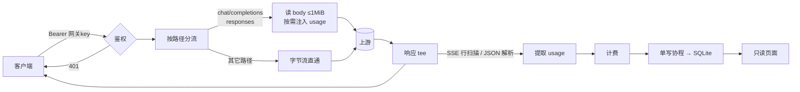

# llmmeter 设计文档

- 日期：2026-10-28
- 状态：待评审
- 模块：`github.com/kiry163/llmmeter`
- 仓库：`git@github.com:kiry163/llmmeter.git`

## 1. 目标

一个本机运行的、极简的 LLM 用量记账网关。客户端把 `base_url` 指向它，它把请求原样转发给单一上游（主要 DeepSeek），旁路记录每次调用的 token 与成本，并用一个只读页面展示统计。

成功标准：

- omp、codex 不改行为地走通网关（含流式）。
- 每次成功请求都能在页面上看到 token 明细与按峰谷规则计算的花费。
- 数字可与 DeepSeek 控制台对账；拿不到 usage 的请求明确标为未计量，不编造。
- 单二进制，常驻内存 20–30 MB，无需外部数据库/缓存。

## 2. 非目标

- 多上游、负载均衡、重试、回退链。
- 协议转换（Responses ↔ Chat Completions）。
- Anthropic / Gemini 协议。
- 非文本接口（图片、音频）的 token 解析。
- 用户体系、配额、限流、多租户。
- 网页端编辑价格。

## 3. 使用场景与约束

- 客户端：omp、codex。codex 使用 OpenAI Responses API（`/v1/responses`），omp 可能使用 `/v1/chat/completions`。
- 上游：单一 OpenAI 兼容端点，官方 key。
- 计价：用户手工配置；支持“基础价 + 时间窗覆盖”的峰谷计价（方案 B）。
- 时间窗按请求**完成时刻**判定，时区可配置（默认 `Asia/Shanghai`），存储统一 UTC。

## 4. 架构

单进程 Go 程序：

- `net/http` 手写反向代理（`httputil.ReverseProxy` 的钩子不足以精细控制请求体与流式响应）。
- 纯 Go SQLite（`modernc.org/sqlite`），WAL 模式，单写协程批量插入。
- 前端为 embed 的单个 HTML + 本地 vendored Chart.js，无 Node、无构建步骤。



### 4.1 请求处理

1. 校验 `Authorization: Bearer <gateway_key>`，常量时间比较；失败返回 401，不触达上游。
2. 复制客户端请求头，去掉 hop-by-hop 头与 `Host`；删除 `Accept-Encoding`，使上游返回未压缩响应。
3. 用配置中的上游 key 覆盖 `Authorization`。
4. 仅当路径为 `/v1/chat/completions`、`stream=true`、且请求体未携带 `stream_options` 时，解析 JSON 并注入 `stream_options.include_usage=true`；其余情况请求体字节不变。
5. 需要解析的路径（`/v1/chat/completions`、`/v1/responses`）body 上限 1 MiB，超限则退化为直通并标记 `too_large`。
6. 其它路径（如 `/v1/audio/*`、图片、`/v1/models`）不读取不解析，纯字节流转发；只写访问日志，不落 usage 表，避免非推断请求污染统计。

### 4.2 响应处理

- 状态码与响应头原样回写，响应体一边写给客户端一边扫描。
- SSE：按行解析 `data:` 负载；忽略 `[DONE]`；单行上限 1 MiB。chat 取最后一个含 `usage` 的 chunk；responses 取 `response.completed` 事件中的 `response.usage`。
- 非流式 JSON：缓冲到 10 MiB 上限后解析；超过上限则直通并标记 `too_large`。
- 客户端提前断开：上游已计费，因此继续读完上游响应（最多 3 秒 / 2 MiB）以尽量取到 usage；仍未取到则 `usage_status=no_usage`。
- 上游 4xx/5xx：原样透传，记录一行零成本与状态码，不重试。

### 4.3 usage 归一化

| 来源 | prompt | completion | cache read | reasoning |
|---|---|---|---|---|
| chat completions | `prompt_tokens` | `completion_tokens` | `prompt_cache_hit_tokens` 或 `prompt_tokens_details.cached_tokens` | `completion_tokens_details.reasoning_tokens` |
| responses | `input_tokens` | `output_tokens` | `input_tokens_details.cached_tokens` | `output_tokens_details.reasoning_tokens` |

DeepSeek 的 `prompt_tokens = prompt_cache_hit_tokens + prompt_cache_miss_tokens`；cache read 视为其中命中部分。未出现的字段记 0。`cache_write_tokens` 为预留列，当前上游不产生。

## 5. 配置

```yaml
listen: "127.0.0.1:8100"
gateway_key: "sk-local-xxx"
timezone: "Asia/Shanghai"

upstream:
  base_url: "https://api.deepseek.com"
  api_key: "${env:DEEPSEEK_API_KEY}"
  timeout: "300s"

pricing:
  models:
    deepseek-chat:
      input_per_mtok: 0.28        # base = 平时价，示例值
      output_per_mtok: 0.42
      cache_read_per_mtok: 0.028
      windows:
        - label: peak
          days: [mon, tue, wed, thu, fri]
          start: "09:00"
          end: "12:00"
          input_per_mtok: 0.56
          output_per_mtok: 0.84
          cache_read_per_mtok: 0.056
        - label: peak
          days: [mon, tue, wed, thu, fri]
          start: "14:00"
          end: "18:00"
          input_per_mtok: 0.56
          output_per_mtok: 0.84
          cache_read_per_mtok: 0.056
```

规则：

- `windows` 按文件顺序取**第一个命中**；未命中任何窗口用 base 价。
- `days` 省略表示每天；`end <= start` 表示跨午夜，起始日按 `days` 判定。
- 窗口内未写的费率字段回落 base。
- `api_key` 支持 `${env:VAR}` 引用。
- `SIGHUP` 重新加载配置（上游地址、key、网关 key、价格、时区）；`listen` 变更需重启。
- 不内置价格表；示例值需用户按账单填写。

## 6. 数据模型

```sql
CREATE TABLE requests (
  id                  INTEGER PRIMARY KEY,
  started_at          TEXT NOT NULL,     -- RFC3339 UTC
  completed_at        TEXT NOT NULL,
  path                TEXT NOT NULL,
  model               TEXT,
  upstream_model      TEXT,
  stream              INTEGER NOT NULL,
  status              INTEGER NOT NULL,
  latency_ms          INTEGER NOT NULL,
  prompt_tokens       INTEGER NOT NULL DEFAULT 0,
  completion_tokens   INTEGER NOT NULL DEFAULT 0,
  cache_read_tokens   INTEGER NOT NULL DEFAULT 0,
  cache_write_tokens  INTEGER NOT NULL DEFAULT 0,
  reasoning_tokens    INTEGER NOT NULL DEFAULT 0,
  total_tokens        INTEGER NOT NULL DEFAULT 0,
  window_label        TEXT,               -- 'base' 或窗口 label
  rates_json          TEXT,               -- 命中时刻费率快照（每 MTok）
  cost_nano_usd       INTEGER NOT NULL DEFAULT 0,
  priced              INTEGER NOT NULL DEFAULT 1,
  usage_status        TEXT NOT NULL,      -- ok | no_usage | parse_failed | too_large
  error               TEXT
);
CREATE INDEX idx_requests_started ON requests(started_at);
CREATE INDEX idx_requests_model ON requests(model);
```

- 成本用整数纳美元累加，展示时转 USD。
- 只有 `/v1/chat/completions` 与 `/v1/responses` 产生记录；其它路径仅写访问日志。
- `priced=0` 表示有 usage 但未配置价格（成本记 0），与 `usage_status` 区分。
- 写入：单写协程 + 有界队列（1024），队列满时同步写入，不丢记录。

## 7. 计费口径

1. 以 `completed_at` 换算到配置时区，选择窗口。
2. 合成费率 = base 覆盖窗口字段。
3. 计算：
   `cost = (prompt − cache_read) × input + cache_read × cache_read + cache_write × cache_write + (completion − reasoning) × output + reasoning × reasoning`
   - 未配置 `reasoning_per_mtok` 时，reasoning 按 output 计价（上式退化为 `completion × output`）。
   - `cache_write` 未配置时按 0 处理（当前上游不产生该字段）。
4. 费率与窗口标签快照进 `rates_json`、`window_label`；改价不影响历史。
5. 模型不在价格表中：tokens 照记，`cost_nano_usd=0`，`priced=0`。

## 8. 页面

单页只读，`/` 提供服务：

- 时间范围：今天 / 7 天 / 30 天 / 自定义。
- 卡片：请求数、tokens（input/output/cache）、花费、未计量次数（`usage_status != ok` 的请求数）。
- 折线：按天花费 / tokens（切换）。
- 模型表：请求数、各类 tokens、花费、未定价次数。
- 请求明细：分页、按模型筛、按状态筛；行展开显示费率快照与命中窗口。
- 导出：当前筛选条件的 CSV / JSON。

JSON 接口：`GET /api/summary`、`/api/daily`、`/api/models`、`/api/requests`、`/api/export.csv`。

页面仅监听回环地址，不做登录；任何本机进程可读取统计（网关 key 只保护推理入口）。

## 9. 运维

- 子命令：`llmmeter serve -config config.yaml [-db llmmeter.db] [-listen addr]`；`llmmeter version`。
- 启动时打开数据库并迁移 schema（`PRAGMA user_version`）。
- 日志：JSON 行到 stdout；不打印 prompt/响应内容。
- `SIGTERM`：停止接收、刷写队列、`wal_checkpoint(TRUNCATE)` 后退出。
- 备份：拷贝单个 `.db` 文件即可。

## 10. 测试与验收

单元测试：

- 窗口匹配：边界（start 含、end 不含）、跨午夜、`days`、首命中、字段回落。
- 计价：cache 拆分、reasoning 拆分、未配置 reasoning、`priced=0`、纳美元取整。
- SSE：usage 行跨 chunk、`[DONE]`、缺少 usage、超大行。
- 请求注入：仅目标路径/条件注入，其余字节完全一致。
- usage 归一化：chat 与 responses 两种字段命名。

集成测试（`httptest` 假上游）：

- 流式与非流式成功路径。
- 客户端断连后继续读完上游。
- 上游 500、上游返回无 usage。
- 非文本路径字节级直通且不解析。
- 队列满时同步落库。

验收：

- 真机各发一次 chat、stream、Responses（codex）请求，页面 tokens 与 DeepSeek 控制台一致。
- 用可注入时钟构造跨峰时窗口的请求，`window_label` 与成本符合预期。
- 空闲内存 ≤ 40 MB，单条请求额外延迟 ≤ 5 ms（本机）。

## 11. 风险

- DeepSeek 的 responses 接口若不在 `response.completed` 中返回 usage，则该类请求会显示未计量；解析器按事件名与字段双路径容错。
- DeepSeek 可能调整 usage 字段名；归一化层集中在一处，便于适配。
- 客户端若自行设置 `stream_options.include_usage=false` 或使用非 SSE 流式格式，usage 可能缺失，按未计量处理。

## 12. 决策记录

- 纯透传而非协议转换：满足 codex/omp，同时把兼容风险降到最低。
- 只支持 OpenAI 兼容：用户明确不需要其它协议。
- 价格只放 YAML：低频变更，避免实现窗口编辑器；`SIGHUP` 热加载。
- 成本整数纳美元：避免浮点累加误差。
- 未计量不估算：以可信账单优先。
