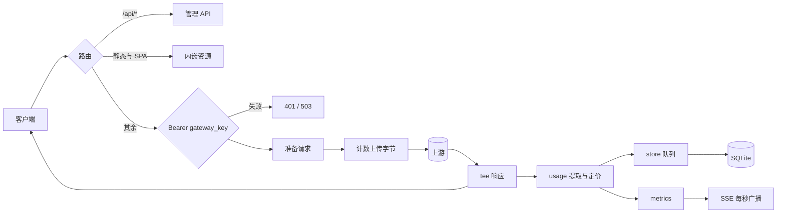

# llmmeter v2 设计文档

- 日期：2026-10-29
- 状态：待评审
- 模块：`github.com/kiry163/llmmeter`
- 取代：`docs/superpowers/specs/2026-10-28-llm-meter-design.md`（保留为历史）

## 1. 目标与非目标

### 1.1 目标

把 llmmeter 从「只读统计页 + YAML 配置」重写为「单二进制、SQLite 即全部状态、WebUI 可配置、带实时流量观测」的本地网关产品。

成功标准：

- omp、codex 通过 `base_url` 指向网关后行为不变，流式与非流式均正常。
- 每次代理请求都落库，包含双向 body 字节与头部字节估计，页面可对账。
- 总览页在 1 秒粒度展示进行中请求、QPS、上下行 B/s、P50/P95、错误数。
- 价格模型与峰谷窗口可在 WebUI 增删改，保存即生效，无需重启。
- 上游连接、时区、保留期、管理密码、gateway key 可在 WebUI 管理。
- 单二进制部署；React 构建产物内嵌；无 Node 运行时、无外部数据库。

### 1.2 非目标

- 多上游、负载均衡、重试、回退链。
- 协议转换（Responses ↔ Chat Completions）。
- 非文本接口的 token 解析（字节与状态照记）。
- 多用户、角色权限、配额。
- 首版不做：未定价模型一键补录、CSV/JSON 导出界面、手动清理界面、价格表批量导入导出。
- 不迁移旧版 YAML 或旧数据库；旧版无实际使用。

## 2. 架构

### 2.1 运行形态

```
llmmeter -db llmmeter.db -listen 127.0.0.1:8100
```

- 无配置文件、无必需环境变量；`-db`、`-listen` 为 flag（也接受 `serve` 子命令前缀）。
- `llmmeter version` 输出版本。
- 全部持久状态在单个 SQLite 文件。
- 内嵌 `time/tzdata`，不依赖系统时区库。

### 2.2 包边界

```
cmd/llmmeter/main.go        装配、信号、优雅关闭
internal/settings/          配置仓储 + atomic 快照
internal/pricing/           窗口编译与成本计算（纯函数）
internal/gateway/           鉴权、透传、字节计数、usage 提取、记录组装
internal/usage/             usage 归一化（纯函数）
internal/store/             schema、单写协程、查询、聚合、清理
internal/metrics/           进行中计数、秒级环形缓冲、SSE hub、分钟增量
internal/api/               REST、会话、静态资源与 SPA fallback
web/                        React 19 + Vite + TS + Tailwind + ECharts
```

### 2.3 路由

优先级从上到下：

1. `/api/*` → 管理 API（会话鉴权或回环免登录）。
2. `/assets/*`、`/favicon.svg` → 内嵌静态资源。
3. 精确命中的 SPA 路由：`/`、`/requests`、`/pricing`、`/settings`、`/setup`、`/login` → `index.html`。
4. 其余全部 → 网关（`Authorization: Bearer <gateway_key>`），包括 `/v1/*` 与未知路径。

新增 SPA 路由必须同步加入第 3 条的路由表。未知路径不再可能被误当静态资源。

### 2.4 请求生命周期



## 3. 配置与热生效

### 3.1 settings 键

| key | 值（JSON） | 说明 |
|---|---|---|
| `upstream` | `{"baseUrl","apiKey","timeoutS"}` | `baseUrl` 必须 http/https 且含 host；`timeoutS` 1–3600，默认 300 |
| `timezone` | `"Asia/Shanghai"` | 必须能被 `time.LoadLocation` 解析 |
| `retentionDays` | `90` | 7–3650 |
| `gatewayKey` | `"sk-local-..."` | 首次 setup 生成 |
| `adminPasswordHash` | Argon2id PHC 字符串 | 缺省表示无密码 |
| `sessionSecret` | base64(32B) | 安装时生成，用于签发 cookie |

上游 key 与 gateway key 明文存库（本地信任模型），API 只返回掩码；任何日志不得输出密钥或请求/响应正文。

### 3.2 价格模型

```sql
CREATE TABLE models (
  id INTEGER PRIMARY KEY, name TEXT NOT NULL UNIQUE,
  input_per_mtok REAL NOT NULL DEFAULT 0,
  output_per_mtok REAL NOT NULL DEFAULT 0,
  cache_read_per_mtok REAL NOT NULL DEFAULT 0,
  cache_write_per_mtok REAL NOT NULL DEFAULT 0,
  reasoning_per_mtok REAL,              -- NULL = 按 output 计价
  created_at TEXT NOT NULL, updated_at TEXT NOT NULL
);

CREATE TABLE price_windows (
  id INTEGER PRIMARY KEY,
  model_id INTEGER NOT NULL REFERENCES models(id) ON DELETE CASCADE,
  label TEXT NOT NULL,
  days_mask INTEGER NOT NULL DEFAULT 127,  -- bit0=Mon .. bit6=Sun
  start_minute INTEGER NOT NULL,            -- 0..1439，含
  end_minute INTEGER NOT NULL,              -- 0..1439，不含；end<start 表示跨午夜
  input_per_mtok REAL, output_per_mtok REAL,
  cache_read_per_mtok REAL, cache_write_per_mtok REAL, reasoning_per_mtok REAL,
  sort_order INTEGER NOT NULL DEFAULT 0
);
```

校验规则：

- `name` 去首尾空白后非空、唯一；费率必须为有限且 ≥0 的数。
- 窗口 `label` 非空；`start_minute`/`end_minute` ∈ [0,1439] 且不相等；`days_mask` ∈ [1,127]；每个模型最多 32 个窗口。
- 窗口覆盖字段为 `NULL` 时回落 base 价；`reasoning_per_mtok` 在 base 与窗口层都允许 `NULL`。
- 整个窗口列表通过 `PUT /api/models/{id}/windows` 原子替换，数组下标即 `sort_order`。

窗口匹配（时间换算到配置时区）：

- `end > start`：命中条件为当天 `days_mask` 包含该星期，且 `start <= minuteOfDay < end`。
- `end < start`：命中条件为（当天星期在 mask 中且 `minuteOfDay >= start`）或（前一天星期在 mask 中且 `minuteOfDay < end`）。
- 按 `sort_order` 升序取第一个命中；未命中用 base，`window_label = "base"`。

### 3.3 生效机制

- 内存 `settings.Snapshot` 与 `pricing.Table` 各由 `atomic.Pointer` 持有；网关与 API 每次请求 `Load()` 一次，单个请求内口径一致。
- 保存流程：校验 → `BEGIN` 写配置/价格 → `COMMIT` → 重建快照与价格表 → 原子交换。
- 重建失败（理论上被校验排除）不得交换，保留旧快照；事务内失败整笔回滚。
- `-listen` 只来自 flag；设置页只回显有效监听与「变更需重启」提示。

## 4. 数据模型与字节口径

### 4.1 schema（`PRAGMA user_version = 1`）

```sql
CREATE TABLE settings (
  key TEXT PRIMARY KEY, value TEXT NOT NULL, updated_at TEXT NOT NULL
);

CREATE TABLE requests (
  id INTEGER PRIMARY KEY,
  started_at TEXT NOT NULL, completed_at TEXT NOT NULL,      -- RFC3339 UTC(ms)
  local_day TEXT NOT NULL, minute_of_day INTEGER NOT NULL,   -- 写入时按快照时区
  path TEXT NOT NULL, path_class TEXT NOT NULL,              -- chat|responses|models|audio|other
  model TEXT NOT NULL DEFAULT '', upstream_model TEXT NOT NULL DEFAULT '',
  stream INTEGER NOT NULL, status INTEGER NOT NULL,
  latency_ms INTEGER NOT NULL, ttft_ms INTEGER,
  req_body_bytes INTEGER NOT NULL, req_header_bytes INTEGER NOT NULL,
  resp_body_bytes INTEGER NOT NULL, resp_header_bytes INTEGER NOT NULL,
  prompt_tokens INTEGER NOT NULL DEFAULT 0, completion_tokens INTEGER NOT NULL DEFAULT 0,
  cache_read_tokens INTEGER NOT NULL DEFAULT 0, cache_write_tokens INTEGER NOT NULL DEFAULT 0,
  reasoning_tokens INTEGER NOT NULL DEFAULT 0, total_tokens INTEGER NOT NULL DEFAULT 0,
  window_label TEXT NOT NULL DEFAULT 'base', rates_json TEXT NOT NULL DEFAULT '',
  cost_nano_usd INTEGER NOT NULL DEFAULT 0, priced INTEGER NOT NULL DEFAULT 0,
  usage_status TEXT NOT NULL,                                -- ok|no_usage|parse_failed|too_large|not_applicable|error
  client_disconnected INTEGER NOT NULL DEFAULT 0,
  error TEXT NOT NULL DEFAULT ''
);
CREATE INDEX idx_requests_started ON requests(started_at);
CREATE INDEX idx_requests_day_class ON requests(local_day, path_class);
CREATE INDEX idx_requests_model_started ON requests(model, started_at);
CREATE INDEX idx_requests_unpriced ON requests(priced) WHERE priced = 0;

CREATE TABLE traffic_minutes (
  local_day TEXT NOT NULL, minute_of_day INTEGER NOT NULL,
  path_class TEXT NOT NULL, model TEXT NOT NULL DEFAULT '',
  requests INTEGER NOT NULL, errors INTEGER NOT NULL,
  req_bytes INTEGER NOT NULL, resp_bytes INTEGER NOT NULL,
  prompt_tokens INTEGER NOT NULL, completion_tokens INTEGER NOT NULL,
  cache_read_tokens INTEGER NOT NULL, reasoning_tokens INTEGER NOT NULL,
  cost_nano_usd INTEGER NOT NULL,
  latency_sum_ms INTEGER NOT NULL, latency_max_ms INTEGER NOT NULL,
  PRIMARY KEY (local_day, minute_of_day, path_class, model)
) WITHOUT ROWID;
```

`http`/`https` 之外的 scheme、非法时间时区等在写入前拒绝。数据库开启 WAL、`synchronous=NORMAL`、`busy_timeout=5000`、`foreign_keys=ON`。

### 4.2 字节口径

| 字段 | 计数来源 |
|---|---|
| `req_body_bytes` | 实际写给上游的请求体字节；注入 `stream_options` 后按重写后字节计 |
| `req_header_bytes` | 请求行 + 转发请求头：`Σ(len(name)+len(value)+4) + 2` |
| `resp_body_bytes` | 从上游读出的响应体字节，包含客户端断连后继续排空的部分 |
| `resp_header_bytes` | 状态行 + 响应头，公式同上 |

- 页面展示 `上传 = req_body + req_header`、`下载 = resp_body + resp_header`，并分开给出 body 精确值。
- 不记录写给客户端的字节（本地回环，无意义）；断连用 `client_disconnected` 标记。
- HTTP/2 下头部字节为估计值，页面对该列标注「估算」。
- `path` 只存 URL path，去掉 query，避免密钥进入数据库。
- `path_class` 映射：`/v1/chat/completions` → `chat`，`/v1/responses` → `responses`，`/v1/models` → `models`，`/v1/audio/` 前缀 → `audio`，其余 → `other`。仅 chat/responses 解析请求体与 usage；`stream` 字段仅对二者从请求体判定，其余为 0。
- `error` 字段截断到 200 字符，只存原因，不含上游正文或密钥。
- 所有代理路径都落库；非 chat/responses 路径不读 body，`model = ""`，tokens/成本为 0，`usage_status = not_applicable`，`priced = 1`（不参与未定价统计）。

### 4.3 usage 与成本

| 来源 | prompt | completion | cache read | reasoning |
|---|---|---|---|---|
| chat completions | `prompt_tokens` | `completion_tokens` | `prompt_cache_hit_tokens` 或 `prompt_tokens_details.cached_tokens` | `completion_tokens_details.reasoning_tokens` |
| responses | `input_tokens` | `output_tokens` | `input_tokens_details.cached_tokens` | `output_tokens_details.reasoning_tokens` |

- 成本（纳美元）：`round(Σ tokens_i × rate_i × 1000)`，rate 为每 MTok 美元；单次求和后四舍五入。
- 分量：`(prompt − cache_read) × input`、`cache_read × cache_read`、`cache_write × cache_write`、`(completion − reasoning) × output`、`reasoning × reasoning`。未配置 reasoning 时用 output；负值按 0 处理。
- 模型不在价格表：tokens 照记，成本 0，`priced = 0`；其余情况 `priced = 1`。
- `usage_status` 语义：
  - `ok`：成功解析出 usage。
  - `no_usage`：上游响应完成但未包含 usage。
  - `parse_failed`：疑似 usage 字段存在但无法解析。
  - `too_large`：请求体/响应体/SSE 行超过缓冲上限，未尝试解析。
  - `not_applicable`：路径不预期产生 usage（非 chat/responses）。
  - `error`：网关未能完成与上游的交换（连接失败、超时、上下文中断），此时通常返回 502。
- 拿不到 usage：成本 0，绝不估算。
- `total_tokens` 优先取上游 `total_tokens`，缺失时取 `prompt + completion`。
- 费率快照（base 合并窗口后的每 MTok 费率、模型名、窗口 label）写入 `rates_json`，改价不影响历史。
- 请求体上限 1MiB，流式单行上限 1MiB，非流式响应缓冲上限 10MiB；超限即透传并标 `too_large`。
- `latency_ms` 从收到请求到读完上游响应；`ttft_ms` 为从收到请求到响应体首字节的毫秒数；两者均以 `completed_at` 落盘。

### 4.4 网关行为

- 客户端 `Authorization: Bearer <gateway_key>` 只用于网关鉴权，转发前替换为配置中的上游 key；随后删除 hop-by-hop 头与 `Host`。
- 删除 `Accept-Encoding`，确保上游返回未压缩响应，便于 usage 解析与字节计数。
- 仅当路径为 `/v1/chat/completions`、请求体 `stream=true` 且未携带 `stream_options` 时，读取（≤1MiB）并注入 `stream_options.include_usage=true`；其余请求体字节不变。
- 响应写回时立即写头并对流式块 `Flush()`；状态码与头部原样透传。
- 客户端提前断开：上游可能已计费，继续读完上游响应（最多 3 秒或 2MiB，先到为准），仍计入字节并标 `client_disconnected=1`；随后按已获信息落库。
- 上游连接失败/超时：返回 502，响应体为统一错误 JSON，并落一条 `usage_status=error` 记录。
- 不重试、不回退、不估算。
- 服务器设置 `ReadHeaderTimeout=10s`、`IdleTimeout=120s`，不设 `WriteTimeout`（长流式）。

## 5. 实时指标

内存结构：

- 进行中请求计数，以及最多 20 条元信息（path_class、model、开始时间）。
- `errors` 口径：`status >= 400` 或 `usage_status = error`；`client_disconnected` 不计入错误，只在明细展示。
- 300 个 1 秒桶：请求数、错误数、上下行字节、延迟直方图 8 桶（50/100/200/400/800/1600/3200/6400ms，末桶含 ∞）。快照/SSE 支持 `?window=60|300`，默认 60；`spark` 点数等于窗口秒数。
- 分钟聚合累加器：`(local_day, minute_of_day, path_class, model)` → 计数与字节/token/成本/延迟和与最大值，另存已刷盘快照。

行为：

- SSE `/api/live/stream` 每秒广播一帧；无订阅者时跳过序列化。请求走 SSE 时 `+1`、结束 `−1`；慢订阅者（缓冲满 8 帧）直接断开。
- `GET /api/live/snapshot` 返回同一负载，供断线轮询兜底。
- 每 5 秒把当前分钟的**增量**通过写协程 upsert（`ON CONFLICT DO UPDATE ... + delta`）；刷盘后更新快照。重复刷入不叠加。崩溃最多丢 5 秒聚合，明细不受影响。
- 分钟切换时清理超过 2 分钟的旧累加器。

帧格式：

```json
{"ts":"2026-10-29T12:00:01+08:00","windowS":60,"inflight":2,"qps":0.62,
 "errors":1,"upBps":1234,"downBps":45678,"latencyP50Ms":800,"latencyP95Ms":2100,
 "byModel":[{"model":"deepseek-chat","qps":0.4,"errors":0}],
 "spark":[{"offsetS":-59,"requests":0,"upBytes":0,"downBytes":0}],
 "inflightRequests":[{"pathClass":"chat","model":"deepseek-chat","elapsedMs":1200}]}
```

## 6. API

统一前缀 `/api`；JSON camelCase；错误体：

```json
{"error":{"code":"validation|unauthorized|forbidden|not_found|conflict|internal","message":"...","fields":{}}}
```

| 方法与路径 | 说明 |
|---|---|
| `GET /api/bootstrap` | `{version, needsSetup, authRequired, listen, timezone}`，无鉴权 |
| `POST /api/setup` | 仅空库可调用：`{upstream:{baseUrl,apiKey,timeoutS}, timezone?, adminPassword?}`；生成 `sk-local-` + 32 位十六进制的 gateway key，仅在响应明文返回；设置密码时同时签发会话 cookie |
| `POST /api/auth/login` | `{password}` → 设置 cookie；5 次/分/IP 限速 |
| `POST /api/auth/logout` | 清 cookie |
| `GET /api/me` | `{authRequired, authenticated}` |
| `GET /api/overview?from&to` | 卡片数据 + 上一等长周期环比 |
| `GET /api/series?from&to&interval=minute\|hour\|day` | 每桶 `requests/errors/upBytes/downBytes/promptTokens/completionTokens/costNanoUsd` |
| `GET /api/breakdown?from&to&by=model\|pathClass` | 分布表，按成本降序 |
| `GET /api/requests?from&to&model&pathClass&status&usageStatus&priced&before_id&limit` | 游标分页，`limit` 1–200；返回 `id < before_id` 的行，按 `id DESC` 排序 |
| `GET /api/requests/{id}` | 单条全量 |
| `GET /api/live/stream`、`GET /api/live/snapshot` | 实时 |
| `GET /api/models` | 模型 + 窗口 |
| `POST /api/models` | `{name, inputPerMTok, outputPerMTok, cacheReadPerMTok, cacheWritePerMTok, reasoningPerMTok?}` |
| `PATCH /api/models/{id}` | 部分更新基础价与名称 |
| `DELETE /api/models/{id}` | 级联删窗口 |
| `PUT /api/models/{id}/windows` | 整表替换 |
| `GET /api/settings` | `{upstream:{baseUrl,apiKey:{set,last4},timeoutS}, timezone, retentionDays, gatewayKey:{set,prefix,last4}, adminPasswordSet, listen, dbPath, dbSizeBytes, version}` |
| `PATCH /api/settings` | 部分更新；`apiKey` 空字符串表示不变；改密需 `currentPassword` |
| `POST /api/gateway-key/rotate` | 返回新 key 一次 |
| `POST /api/upstream/test` | `{baseUrl, apiKey?}` 探测 `/models`，5s 超时 |
| `GET /api/health` | 无鉴权：`{ok, dbWritable, queueDepth, version}` |

`GET /api/settings` 掩码规则：上游 key 与 gateway key 只返回 `set: true` 与末 4 位（gateway key 额外返回前缀），密码只返回 `set`。

通用约定：

- `from`/`to` 为配置时区的本地日期 `YYYY-MM-DD`，`to` 当天包含在区间内；缺省 `to` = 今天，`from` = `to − 6 天`。
- `interval` 上限：`minute` 仅允许 ≤2 天区间，`hour` 仅允许 ≤90 天，超出返回 `validation` 错误；前端按此自动选择。
- `PATCH` 语义：字段省略 = 不变；`reasoningPerMTok` 显式 `null` = 回落 output。`PATCH /api/settings` 中 `apiKey` 为空字符串表示不变。
- 管理密码：`newPassword` 非空即设置；清空密码仅在回环监听时允许（否则重启会拒绝启动）。
- 删除价格模型不影响历史记录（费率已快照）。
- `PUT /api/models/{id}/windows` 传空数组表示清空窗口。
- `POST /api/upstream/test` 在 setup 完成前允许从回环调用（用于引导页「测试连接」）。
- setup 未提供 `timezone` 时默认 `Asia/Shanghai`；引导页默认填浏览器时区。

## 7. 前端

### 7.1 页面

顶层导航：总览 / 请求 / 价格 / 设置；右上角实时状态点与时区标签。

- **总览**：实时卡片（当前请求、QPS、上下行 B/s、P95、错误率）+ 60s sparkline；区间卡片（今天/24h/7d/30d/自定义）含环比；主图可切流量/请求/tokens/成本，间隔自动（≤24h 分钟、≤7d 小时、更久天）；模型分布表可排序，未定价行带徽标。
- **请求**：筛选条（时间、模型、路径类、状态、usageStatus、priced）；表格列含时间、路径类、模型、状态、耗时、上下行、tokens、成本；行点击右侧抽屉展示费率快照与字节明细。
- **价格**：模型列表与抽屉编辑器；基础价四项（reasoning 留空 = 继承 output）；窗口编辑用星期芯片 + 时间输入，覆盖项留空表示继承；提交前校验重名、时间范围、days_mask；保存后提示热生效。
- **设置**：上游（base_url、key 掩码与替换、超时、测试连接）、时区、保留天数、管理密码、gateway key（掩码、轮换后明文一次）、有效监听与重启提示、DB 路径与体积、版本。
- **引导 `/setup`**：上游 → 生成 gateway key（可复制）→ 可选密码；完成后进入总览。
- **登录 `/login`**：仅在已设管理密码且未持有效 cookie 时出现；密码错误提示，成功后回跳原页面。

### 7.2 实现约定

- TanStack Query 管服务端状态；筛选条件进 URL query，可刷新保持。
- 组件自建：Button/Input/Select/Dialog/Drawer/Table/Toast/Badge；Tailwind token 统一颜色与间距。
- ECharts 仅封装折线/柱状两个 wrapper；不引入 UI 组件库。
- SSE 断线指数退避重连，连续失败切 5s 轮询；状态点如实显示当前模式。
- 字节、token、成本、耗时统一走 `format.ts`，成本以纳美元转 USD，保留合适小数。
- 布局响应式：窄屏下导航折叠为底栏，实时卡片与图表单列，表格横向滚动。

### 7.3 构建与内嵌

- `web/package.json`：`npm run build` = `tsc -b && vite build`。
- 根 `Makefile`：`make web`（`npm ci && npm run build`）、`make build`（web + `go build`）、`make dev`（后端 + Vite dev proxy）。
- Go `//go:embed all:dist`；`web/dist/.gitkeep` 保证无构建产物也能编译；提交 `package-lock.json`，忽略 `dist/`。
- Vite dev 将 `/api` 代理到 `127.0.0.1:8100`。

## 8. 鉴权与安全

- 密码 Argon2id（m=64MiB, t=3, p=2，PHC 编码）；比较使用常量时间实现。
- 未设密码且请求源为回环 → 管理 API 免登录；非回环且无密码 → 拒绝启动并提示先设密码。
  - 操作路径：先用 `-listen 127.0.0.1:8100` 启动、在设置页设置密码，再改 `-listen` 重启。密码存于同一 DB，重启后生效。
- 会话 cookie = `base64(payload).HMAC-SHA256(sessionSecret)`，`HttpOnly; SameSite=Strict; Max-Age=43200`；payload 含过期时间与 `auth_epoch`（密码哈希前缀），改密即全端失效；登出清 cookie。
- 非 GET 请求校验：`Origin` 与自身 host 一致，或携带 `X-Requested-With: llmmeter`（前端统一添加）；两者都没有则拒绝。这样脚本可用自定义头调用，浏览器跨站请求仍被拦截。
- 推理入口独立鉴权：`Authorization: Bearer <gateway_key>`，常量时间比较；未配置时返回 503 并提示 `/setup`。
- `/api/*` 与会话、网关 key 互不通用。
- 日志只记方法、路径（去 query）、状态、耗时、字节、模型；不记正文与密钥。

## 9. 写入、查询与运维

### 9.1 单写协程

- 一个写协程串行处理：明细批量插入、分钟聚合增量 upsert、保留期清理、checkpoint。
- 明细队列容量 1024；满则阻塞调用方（不丢记录）。实时指标在入队前更新。
- 批量策略：最多 128 条或 10ms 一批。

### 9.2 查询口径

- 卡片、`series`、`breakdown` 的和值来自 `traffic_minutes`（永久、5 秒延迟内准确）；页面对「最近 5 秒」只用实时卡片呈现。
- `breakdown` 的 unpriced 计数额外查询 `requests`（仅保留期内），超出保留期时该列为空并在 UI 标注。
- P50/P95 由 `requests` 按 100ms 分桶 `GROUP BY` 近似；区间超过保留期时改用聚合的 `latency_sum/count` 均值与最大值，并在 UI 标注。
- 未定价/未计量计数来自 `requests`；区间超出保留期时 UI 标注「仅统计保留期内」。

### 9.3 保留与关闭

- 每日本地 03:00 分批删除 `started_at < now - retentionDays` 的明细，每批 ≤1 万行；不阻塞写入。
- 关闭：停止接受连接 → 等待在途 ≤10 秒 → 刷聚合增量 → 排空队列 → `wal_checkpoint(TRUNCATE)`。
- DB 体积在设置页展示；备份即复制单个 `.db` 文件。

### 9.4 性能预算

- 字节计数包装 `io.Reader`/`io.Writer`，零拷贝；单请求新增延迟目标 <0.2ms。
- SSE 每秒一次序列化后扇出，慢消费者断开。
- 空载常驻内存目标 <60MB。

## 10. 测试与验收

单元测试：

- 价格：窗口边界（start 含、end 不含）、跨午夜、`days_mask`、首命中、字段回落、reasoning 继承、纳美元取整。
- usage：chat 与 responses 两种字段命名、缺失字段、异常类型。
- gateway 集成（`httptest` 假上游）：非流式/流式/注入 `stream_options` 后字节精确值；全路径落库；上游 5xx；客户端断连后继续排空；query 被剥离；header 字节公式；`too_large` 分支。
- metrics：假时钟窗口滚动、分位合并、5 秒增量刷盘幂等。
- store：批量写、队列满阻塞、聚合 upsert、清理、空库建表、读取连接与写入并发。
- api：回环免登录、密码登录/限速/改密失效、Origin 校验、密钥掩码与部分更新、窗口校验、游标分页、setup 只能一次。

冒烟（必须实际执行）：

- `make web && go build` 成功；无 `dist` 时仍可编译。
- 起假上游，发送 chat、stream、非 usage 路径请求，浏览器核对：实时卡片在 1s 内更新、明细字节与假上游收到/发出字节一致、改价后新请求成本按新价、旧记录不变。
- 配置改上游 `base_url` 后不重启即生效；改 `listen` 显示重启提示。

## 11. 风险与对策

| 风险 | 对策 |
|---|---|
| DeepSeek responses 不在 `response.completed` 带 usage | 解析器按事件名与字段双路径容错；缺失标 `no_usage`，不估算 |
| HTTP/2 头部字节为估计 | UI 标注「估算」；body 字节始终精确 |
| 分钟聚合崩溃丢最多 5 秒 | 只影响总量口径的 5 秒；明细可补齐；重启后从当前分钟继续 |
| SQLite 写争用 | 单写协程串行；读走 WAL；清理分批 |
| SSE 订阅者泄漏 | 有界缓冲，满即断开；连接关闭即注销 |
| 时区变更导致历史分组口径变化 | `local_day`/`minuteOfDay` 写入时快照，变更只影响之后的数据 |
| 非回环监听无 TLS，密码与 cookie 明文过网 | 文档明确建议：只在可信内网使用，或置于 HTTPS 反向代理（如 Caddy/Tailscale）之后；不做内置 TLS |

## 12. 决策记录

- 重写而非增量改造：旧版无实际使用，避免 YAML/SQLite 双真源与迁移代码。
- SQLite 为唯一真源：UI 直接 CRUD，避免原子写文件、丢注释与双套校验。
- 全路径建记录：流量监控需要非 usage 路径的字节与状态。
- body 字节精确 + 头部字节估计：不引入高成本估算，同时给出近似线网流量。
- 分钟聚合永久、明细 90 天：总量可长期看，近三个月可逐请求对账。
- 实时用 SSE + 内存环形缓冲：秒级体验，DB 只承担 5 秒增量。
- 无 YAML：首启 setup 引导，减少一个配置面。
- 密码可选、回环默认：本地零摩擦，同时允许非回环部署且默认拒绝裸奔。
- 价格窗口整表替换：避免逐条编辑的顺序与并发竞态。
