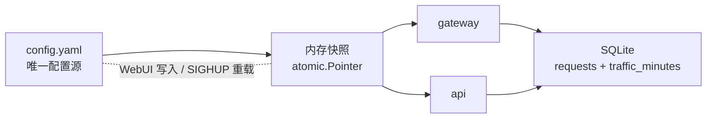
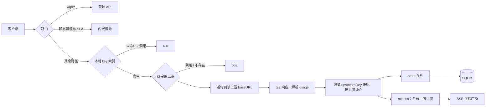

# llmmeter 开源版设计文档

- 日期：2026-10-31
- 状态：待评审
- 模块：`github.com/kiry163/llmmeter`
- 范围：产品定位、YAML 配置层、多上游与本地 key、按上游计费、数据模型、HTTP API、Web UI、开源交付
- 取代：`2026-10-28-llm-meter-design.md`、`2026-10-29-llmmeter-v2-design.md`、`2026-10-30-llmmeter-ui-redesign-design.md` 中与配置来源、单上游、鉴权、信息架构相关的部分。历史文档保留，不作为实现依据。

## 1. 目标与非目标

### 1.1 一句话定位

本机运行的多上游 OpenAI 兼容网关 + LLM 成本仪表盘。客户端拿哪个本地 key，就打到 key 绑定的那个上游。它不是路由器。

### 1.2 目标用户与场景

- 个人开发者：同时使用 DeepSeek、OpenRouter、OpenAI 等，想知道钱花在哪、缓存省了多少。
- 小团队单机或内网部署：一台机器做统一出口，按设备分发本地 key，只做成本观测。
- 隐私敏感用户：不想把 usage、模型名、API key 交给 SaaS；配置和数据都在本机。

### 1.3 成功标准

- 新用户从下载到看到第一笔请求成本不超过 5 分钟。
- 新增一个上游只需要：填 baseURL、上游 key、生成一个本地 key；不需要理解路由规则。
- 配置与数据可分别备份：`config.yaml` 是人可读的唯一配置源，SQLite 只存用量数据。
- 同名模型走不同上游时，成本按各自上游价格计算，统计不混淆。
- 单二进制运行，不依赖 Node 或外部数据库；前端构建产物内嵌。
- 开源仓库具备许可证、英文 README、CI、Release、Docker、Homebrew 与可复现的配置参考。

### 1.4 非目标

- 不做模型名路由、路径前缀路由、失败回退、重试、负载均衡。
- 不做多用户、RBAC、按 key 配额。
- 不做预算、阈值告警、webhook、邮件通知。
- 不做 Prompt/响应正文留存、会话追踪、trace。
- 不做协议转换（Responses ↔ Chat Completions）。
- 不做 token 估算；上游不给 usage 就如实标记。
- 不做 Prometheus、OpenTelemetry、CSV 导出体系。
- 不做旧数据库、旧 YAML 的迁移或兼容。
- 不做 UI 国际化；界面中文，README 提供中英双份。

### 1.5 产品原则

1. **本地优先**：默认只听 `127.0.0.1`，无账号、无遥测，唯一外部请求是上游 API。
2. **精确而非估算**：token 只来自上游 usage；拿不到就标记状态，不猜。成本按请求完成时的费率快照计算。
3. **配置可携、数据可删**：配置是 YAML，数据是一个 SQLite；两者可独立备份、迁移、版本化。
4. **多上游靠绑定，不靠路由**：本地 key 是唯一选择器；没有映射、回退、负载均衡。
5. **功能克制**：一级页面保持四个；不为“看起来完整”加入团队权限、Prompt 存储、预算系统。

## 2. 术语

| 术语 | 含义 |
| --- | --- |
| 上游 | 一个 OpenAI 兼容服务，由 `base_url` + `api_key` 定义；可以有零个或多个本地 key |
| 上游 key | 访问上游的凭据，保存在配置文件中，列表接口只返回掩码 |
| 本地 key | 客户端使用的 `sk-local-…`；唯一绑定到一个上游，是选择上游的唯一方式 |
| 请求明细 | `requests` 表中的一行，保留期默认 90 天 |
| 分钟聚合 | `traffic_minutes` 表中按本地日、分钟、路径类、上游、模型聚合的永久数据 |
| 已定价 | 该模型在所属上游的价格表中存在条目；成本可以为 0 |
| 未定价 | 该模型在所属上游没有价格条目；token 照记，成本 0 |

## 3. 系统架构

### 3.1 运行形态

```bash
llmmeter serve -config ~/.config/llmmeter/config.yaml
llmmeter -config ~/.config/llmmeter/config.yaml -listen 127.0.0.1:8100 -db ~/.cache/llmmeter/llmmeter.db
llmmeter version
```

- `serve` 可省略。
- 首次启动时配置文件不存在则自动生成带注释的 YAML 模板并继续启动；没有独立写配置的子命令。
- `-config` 缺省为 `$XDG_CONFIG_HOME/llmmeter/config.yaml`，未设置时 `~/.config/llmmeter/config.yaml`。
- `-db` 缺省取配置中的 `server.database`；配置未写时取 `$XDG_CACHE_HOME/llmmeter/llmmeter.db`，未设置时 `~/.cache/llmmeter/llmmeter.db`。
- `-listen` 缺省取配置中的 `server.listen`；配置未写时 `127.0.0.1:8100`。
- 优先级：命令行 flag > 配置文件 > 默认值。
- 单实例运行。v1 不实现跨进程锁；同一份配置和数据库不要被两个进程同时使用。

### 3.2 包边界

| 包 | 职责 |
| --- | --- |
| `main` | flag 解析、路径解析、装配、信号、优雅关闭 |
| `internal/config` | YAML 解析、校验、原子写、快照、SIGHUP 重载、路径与权限 |
| `internal/pricing` | 价格窗口编译、费率匹配、成本计算（纯函数） |
| `internal/pricecatalog` | 内嵌价格预设、provider/模型匹配（纯函数） |
| `internal/gateway` | 本地 key 鉴权、上游绑定、透传、字节计数、usage 提取、记录组装 |
| `internal/usage` | usage 归一化（纯函数） |
| `internal/store` | schema v2、单写协程、查询、聚合、保留清理 |
| `internal/metrics` | 全局与按上游的进行中计数、秒级环形缓冲、SSE hub、分钟增量 |
| `internal/api` | 管理 REST、会话、静态资源、SPA fallback |
| `web` | React 19 + Vite + TS + ECharts |

现有 `internal/settings` 包与数据库中的 `settings` / `models` / `price_windows` 表整体删除，由 `internal/config` 取代。

### 3.3 配置与数据分离



- 配置变更不写数据库；数据写入不碰配置文件。
- 请求处理期间只读取一次内存快照，保证单请求内的上游、费率、时区口径一致。

### 3.4 请求生命周期



## 4. 配置文件

### 4.1 路径与优先级

| 项 | 默认 | 覆盖 |
| --- | --- | --- |
| 配置文件 | `$XDG_CONFIG_HOME/llmmeter/config.yaml` 或 `~/.config/llmmeter/config.yaml` | `-config` |
| 数据库 | `$XDG_CACHE_HOME/llmmeter/llmmeter.db` 或 `~/.cache/llmmeter/llmmeter.db` | 配置 `server.database`，再覆盖以 `-db` |
| 监听 | `127.0.0.1:8100` | 配置 `server.listen`，再覆盖以 `-listen` |

- 配置中的 `database` 支持 `~` 展开；相对路径相对于配置文件所在目录解析。
- 配置目录与数据库目录不存在时创建，目录权限 `0700`；配置文件与数据库文件权限 `0600`（WAL/SHM 由 SQLite 创建，启动后按同权限收敛）。
- 配置文件不存在时，启动先写入一份带注释的模板（字段见 4.5），再按该文件启动。

### 4.2 格式

- 使用 YAML，严格解析：未知字段、重复 key、类型错误都启动失败。
- 顶层 `version` 必须为 `1`。
- 费率单位统一为 **USD / 百万 token**。
- 峰谷窗口用可读的 `days` 与 `HH:MM`，不暴露内部的 `days_mask` 与分钟数。
- 完整示例见附录 A。

### 4.3 校验规则

| 字段 | 规则 |
| --- | --- |
| `version` | 必须为 `1` |
| `server.listen` | 合法 `host:port`；非回环地址时必须已有 `auth.admin_password_hash` |
| `server.database` | 非空；展开 `~` 后可用 |
| `general.timezone` | 必须能被 `time.LoadLocation` 解析 |
| `general.retention_days` | `7..3650` |
| `auth.admin_password_hash` | 空，或合法 Argon2id PHC 字符串 |
| `auth.session_secret` | 空，或 base64 编码的 32 字节；为空时启动生成并尝试写回 |
| `upstreams[].id` | 必填，匹配 `[a-z0-9][a-z0-9-]{0,31}`，全局唯一 |
| `upstreams[].name` | 去空白后非空，最大 100 字符 |
| `upstreams[].base_url` | 必填，`http`/`https`，含 host；末尾 `/` 归一化去掉 |
| `upstreams[].api_key` | 可空；为空时不向上游发送 `Authorization` |
| `gateway_keys[].id` | 必填，全局唯一，匹配 `[a-z0-9][a-z0-9-]{0,31}` |
| `gateway_keys[].name` | 去空白后非空，最大 100 字符 |
| `gateway_keys[].key` | 全局唯一，长度 ≥ 16 |
| `gateway_keys[].upstream_id` | 必填，必须引用存在的 `upstreams[].id` |
| `upstreams[].models[].name` | 同上游内唯一，非空，最大 200 字符 |
| 费率 | 有限且 ≥ 0 |
| `windows` | 每个模型最多 32 个；`label` 非空；`days` 是 `mon..sun` 的非空无重复子集；`start`/`end` 为 `HH:MM` 且不相等；`end < start` 表示跨午夜 |
| 窗口覆盖费率 | 省略或 `null` 表示继承该模型的 base 价 |

配置中零个上游是合法状态：服务正常运行，配置写接口仍可用，以便添加第一个上游。`gateway_keys` 可以为空；上游也可以没有绑定 key，但 UI 必须显示“该上游不可用”的警告。每个 `gateway_keys[].upstream_id` 必须指向存在的上游。

### 4.4 写入与生效

- 所有写操作走同一个 `config.Store`，用互斥锁串行化。
- 流程：深拷贝当前配置 → 应用修改 → 全量校验 → 序列化 → 临时文件 + `fsync` + `rename` + 目录 `fsync`（尽力） → 原子替换内存快照。
- 任一步失败都不替换快照，API 返回错误；磁盘上保留旧文件。
- WebUI 保存后立即生效：上游、本地 key、价格、时区、保留天数。
- `server.listen` 与 `server.database` 写入文件但需要重启；UI 显示明确提示。`SIGHUP` 重载时这两个字段也只更新文件内容，不改变当前进程的有效监听与数据库连接。
- 修改时区只影响之后的请求 bucketing、清理调度与窗口判断；历史 `local_day` 不重算。
- 手工编辑 YAML 后，Unix 上发送 `SIGHUP` 重载。重载失败保留旧快照并记录错误，不让服务半坏。
- Windows 不支持 `SIGHUP`，手工编辑后重启。
- UI 保存会重新序列化文件，手写注释可能丢失；文件头注释由程序固定写入。
- 外部编辑与 UI 保存并发时，最后写入者生效；v1 不做文件级冲突检测。

### 4.5 首次启动与配置模板

不存在首次配置向导页面，也没有独立写配置命令；配置来源只有 YAML 与运行期 WebUI 管理。

- 启动时若配置文件不存在，先写入带注释的模板并继续启动：
  - `version: 1`
  - `server.listen`、`server.database` 使用本次解析出的有效值
  - `general.timezone` 使用 `time.Local.String()`（`time.LoadLocation` 可解析）
  - `general.retention_days: 90`
  - `auth.admin_password_hash`、`auth.session_secret` 为空；启动后 `ensureSessionSecret` 生成并写回 session secret
  - `upstreams: []`、`gateway_keys: []`，注释说明可在 YAML 或 WebUI 添加第一个上游与本地 key
- 文件已存在时不做任何修改；内容是否合法由加载阶段校验。
- 模板通过既有原子写落盘，文件 `0600`，新建目录 `0700`。
- 零上游时服务正常运行：面板可登录、读空配置，并可创建第一个上游/key；网关返回 `503 not_configured`。
- 上游、key、价格、时区、保留天数可在 WebUI 保存；`listen` 与 `database` 修改后需重启。
- 第一次保存会用常规序列化重写文件，模板注释不保证保留。

### 4.6 安全

- 配置文件包含上游 key、本地 key、管理员哈希、session secret，权限必须 `0600`；已存在但权限过宽时尝试 `chmod 0600`，失败则记录警告。
- 配置目录 `0700`。
- 日志、错误响应、调试输出永不包含完整 key。
- 列表 API 只返回掩码；完整值通过单独的 reveal 接口读取，且 `Cache-Control: no-store`。
- 备份配置等于备份密钥；README 必须明确提示。

### 4.7 限制

- v1 假设单实例；不实现跨进程文件锁。
- YAML 注释不保证在 UI 保存后保留。
- 手工编辑在运行中不会自动发现，需要 `SIGHUP` 或重启。
- 配置中的密钥是明文；靠文件权限和本机信任模型保护。

## 5. 多上游与鉴权

### 5.1 配置模型

```yaml
upstreams:
  - id: deepseek
    name: DeepSeek
    base_url: https://api.deepseek.com
    api_key: sk-...
    enabled: true
    models: []
  - id: openrouter
    name: OpenRouter
    base_url: https://openrouter.ai/api/v1
    api_key: sk-or-...
    enabled: true
    models: []

gateway_keys:
  - id: macbook
    name: MacBook
    key: sk-local-...
    upstream_id: deepseek
    enabled: true
```

- `gateway_keys` 是顶层列表；每个本地 key 有且只有一个 `upstream_id`。
- WebUI 可直接把某个 key 改绑到另一个上游；保存后新请求立即走新上游，客户端使用的 key 不变。
- 价格跟随上游，不跟随 key；改绑后按目标上游的价格表计价，目标上游未配置的模型变为未定价。
- 已在途的请求保持开始时绑定的上游与费率快照，改绑只影响之后的请求。
- 一个上游可以被多个本地 key 使用，也可以没有本地 key。
- 上游 key 为空时，网关不向上游发送 `Authorization`，支持 Ollama、LM Studio 等本地服务。
- 上游禁用时，绑定到它的所有本地 key 立即失效。

### 5.2 路由

1. 从 `Authorization: Bearer <key>` 读取本地 key。
2. 在内存索引中按 SHA-256 哈希查找绑定 `{upstreamID, keyID}`。
3. 未命中或 key 禁用：`401`，错误码 `invalid_api_key`。
4. 绑定不存在或上游禁用：`503`，错误码 `upstream_disabled`。
5. 目标 URL：`strings.TrimRight(baseURL, "/") + r.URL.Path + "?" + RawQuery`，路径原样透传。
6. 上游 key 非空时用 `Authorization: Bearer <upstream key>` 覆盖客户端头；为空时删除该头。
7. 其余请求头照旧透传，剥离 hop-by-hop 头与 `Host`。

不做任何基于模型名、路径、header 的上游选择或改写。

### 5.3 本地 key 生命周期

- 生成：`sk-local-` + 32 字节加密随机数的 base64url 编码，约 52 字符。
- 创建后可随时通过 reveal 读取完整值。
- 轮换：生成新值并原子替换配置；旧值立即失效，无需重启。
- 禁用：配置 `enabled: false`，请求返回 `401`。
- 删除：从配置移除；历史请求保留 key 名称快照。
- 改绑：更新 `gateway_keys[].upstream_id` 并原子替换配置；新请求立即生效，客户端 key 不变。
- 最近使用：从 `requests` 表按 `key_id` 取 `MAX(started_at)`；改绑后该时间可能来自旧上游，仅表示“这个 key 最近被用过”。
- 同名 key 允许；`id` 由服务端生成且不可变。

### 5.4 显示与掩码

- 列表只返回 `keyMasked` / `apiKeyMasked`：保留可识别前缀与末四位，例如 `sk-local-8f3a…9c21`。
- 掩码规则：长度 ≤ 12 时全部替换为 `…`；否则保留前 8 与后 4，中间用 `…`。
- 完整值通过 `GET /api/keys/{keyId}/secret` 与 `GET /api/upstreams/{id}/secret` 获取。
- 前端默认打码，点击“显示”后展示完整值，提供复制按钮；再次点击隐藏。
- reveal 接口要求管理会话或回环访问，响应带 `Cache-Control: no-store`。

### 5.5 重命名与删除

- 上游 `id` 不可变；`name`、`base_url`、`api_key`、`enabled` 可改。
- 本地 key 的 `id` 不可变；`name`、`enabled`、`upstream_id` 可改，值通过轮换改变。
- 请求记录保存 `upstream_id`、`upstream_name`、`key_id`、`key_name` 快照；改名、改绑或删除上游不改变历史显示。
- 删除上游前必须先转移或删除绑定到它的所有本地 key；否则 `DELETE` 返回 `409 upstream_in_use`，UI 列出待处理的 key。
- 删除允许；如果删到零个上游，UI 显示空状态，网关返回 `503 not_configured`。
- 删除最后一个上游或最后一个 key 只做二次确认，不做额外阻止。

### 5.6 实时指标

- metrics hub 为全局与每个上游分别维护进行中计数、秒级环形缓冲、延迟直方图，以及 prompt/cache-read token 累计，用于实时缓存命中率。
- 快照与 SSE tick 同时返回 `total`、`byUpstream`、`byModel`；`byModel` 条目带 `upstreamId`。
- 前端切换上游筛选时不重连 SSE，只切换读取 `byUpstream[id]` 或 `total`。
- 每个上游的 spark 随 `byUpstream[id].spark` 返回，保证实时条与筛选口径一致。

### 5.7 网关错误形状

网关自身的错误统一为 OpenAI 兼容形状：

```json
{"error":{"message":"invalid gateway key","type":"invalid_request_error","code":"invalid_api_key"}}
```

| 场景 | HTTP | code |
| --- | --- | --- |
| 未配置上游 | 503 | `not_configured` |
| key 缺失/错误/禁用 | 401 | `invalid_api_key` |
| 上游禁用/绑定缺失 | 503 | `upstream_disabled` |
| 上游连接失败 | 502 | `upstream_error` |

上游自身的响应（包括错误体）原样透传，不改写。

### 5.8 保持不变的网关行为

除上游选择与鉴权外，现有透传语义原样保留：

- 流式 chat 请求缺少 `stream_options` 时注入 `include_usage`；其余请求体不改写。
- 不做协议转换、不重试、不回退、不估算 token。
- 上游请求不设网关侧超时；客户端断开后继续读完上游，以便补全 usage 与字节。
- 请求体字节按实际发往上游的字节计；响应体字节按未透明解压的线上字节计。
- 请求/响应头字节按 HTTP/1.1 文本格式估算。
- usage 仅解析 `/v1/chat/completions` 与 `/v1/responses`；拿不到时标记 `no_usage`、`parse_failed`、`too_large`、`not_applicable` 或 `error`。
- 日志与抽屉中的 tokens/s、缓存节省与速率快照口径不变，只是增加上游维度。

## 6. 数据模型

### 6.1 Schema v2

新库直接创建以下结构，`PRAGMA user_version = 2`。

```sql
CREATE TABLE requests (
  id INTEGER PRIMARY KEY,
  started_at TEXT NOT NULL,
  completed_at TEXT NOT NULL,
  local_day TEXT NOT NULL,
  minute_of_day INTEGER NOT NULL,
  path TEXT NOT NULL,
  path_class TEXT NOT NULL,
  upstream_id TEXT NOT NULL,
  upstream_name TEXT NOT NULL,
  key_id TEXT NOT NULL,
  key_name TEXT NOT NULL,
  model TEXT NOT NULL DEFAULT '',
  upstream_model TEXT NOT NULL DEFAULT '',
  stream INTEGER NOT NULL,
  status INTEGER NOT NULL,
  latency_ms INTEGER NOT NULL,
  ttft_ms INTEGER,
  req_body_bytes INTEGER NOT NULL,
  req_header_bytes INTEGER NOT NULL,
  resp_body_bytes INTEGER NOT NULL,
  resp_header_bytes INTEGER NOT NULL,
  prompt_tokens INTEGER NOT NULL DEFAULT 0,
  completion_tokens INTEGER NOT NULL DEFAULT 0,
  cache_read_tokens INTEGER NOT NULL DEFAULT 0,
  cache_write_tokens INTEGER NOT NULL DEFAULT 0,
  reasoning_tokens INTEGER NOT NULL DEFAULT 0,
  total_tokens INTEGER NOT NULL DEFAULT 0,
  window_label TEXT NOT NULL DEFAULT 'base',
  rates_json TEXT NOT NULL DEFAULT '',
  cost_nano_usd INTEGER NOT NULL DEFAULT 0,
  priced INTEGER NOT NULL DEFAULT 0,
  usage_status TEXT NOT NULL,
  client_disconnected INTEGER NOT NULL DEFAULT 0,
  error TEXT NOT NULL DEFAULT ''
);

CREATE INDEX idx_requests_started ON requests(started_at);
CREATE INDEX idx_requests_upstream_started ON requests(upstream_id, started_at);
CREATE INDEX idx_requests_upstream_key_started ON requests(upstream_id, key_id, started_at);
CREATE INDEX idx_requests_model_started ON requests(model, started_at);
CREATE INDEX idx_requests_unpriced ON requests(priced) WHERE priced = 0;

CREATE TABLE traffic_minutes (
  local_day TEXT NOT NULL,
  minute_of_day INTEGER NOT NULL,
  path_class TEXT NOT NULL,
  upstream_id TEXT NOT NULL,
  model TEXT NOT NULL DEFAULT '',
  requests INTEGER NOT NULL,
  errors INTEGER NOT NULL,
  req_bytes INTEGER NOT NULL,
  resp_bytes INTEGER NOT NULL,
  prompt_tokens INTEGER NOT NULL,
  completion_tokens INTEGER NOT NULL,
  cache_read_tokens INTEGER NOT NULL,
  reasoning_tokens INTEGER NOT NULL,
  cost_nano_usd INTEGER NOT NULL,
  latency_sum_ms INTEGER NOT NULL,
  latency_max_ms INTEGER NOT NULL,
  PRIMARY KEY (local_day, minute_of_day, path_class, upstream_id, model)
) WITHOUT ROWID;
```

- 不再有 `settings`、`models`、`price_windows` 表。
- `rates_json` 快照包含 `upstream_id`、模型名、命中窗口、五项费率。
- 分钟聚合不记录 key 维度；key 维度只在保留期内的 `requests` 中可查。

### 6.2 Schema 版本与不迁移

- 数据库文件不存在：创建 schema v2。
- `PRAGMA user_version == 2`：正常启动。
- 其他值（包括旧版 v1）：启动失败，输出：

  ```
  incompatible database schema (found 1, need 2): start with a new database path or remove this file
  ```

- 不写迁移代码、不自动备份、不改写旧库。
- 默认新路径 `~/.cache/llmmeter/llmmeter.db` 与旧版默认 `~/llmmeter.db` 不同，正常升级不会撞库；用户显式 `-db` 指向旧库时按上面的规则失败。

### 6.3 保留与清理

- 请求明细默认保留 90 天，可配置 `7..3650` 天。
- 每天配置时区的 03:00 清理过期明细；retention 变更后重新计算下一次执行时间。
- `traffic_minutes` 永久保留，明细清理后总览、趋势、模型/路径排名仍有数据。
- 依赖明细的统计（未定价计数、延迟分位、Top 请求、缓存节省、健康异常计数）在区间早于保留期时标记 `partial=true`，UI 置灰并提示“仅保留期内”。
- 不提供手动清理 UI。

### 6.4 快照字段

请求开始时固定：

- `upstream_id`、`upstream_name`
- `key_id`、`key_name`
- 请求模型名（来自请求体；缺失时回退上游返回的模型名）
- 上游模型名
- 路径、路径类、流式标记

请求完成时写入：

- 状态、耗时、首字、双向字节
- usage 字段与 `usage_status`
- 计费窗口、`rates_json`、成本、`priced`
- 客户端断开、错误信息

### 6.5 聚合口径

- `traffic_minutes` 按 `(local_day, minute_of_day, path_class, upstream_id, model)` upsert。
- `models`/`paths`/趋势在“全部上游”时保留上游维度，不做跨上游同名模型合并。
- 健康区块的请求数、错误数、错误率来自聚合；未计量、`too_large`、客户端断开、P95 来自明细，`partial` 时置灰。
- `earliestDay` 取 `traffic_minutes` 中最早有数据的本地日期，全局统计。

## 7. 计费

### 7.1 按上游独立

- 价格模型的身份是 `(upstream_id, model_name)`；同名模型在不同上游是两条独立价格条目，不共享费率、窗口或定价状态。
- 每个上游编译一份独立的 `pricing.Table`。
- 网关按请求开始时绑定的上游取表、匹配窗口、写费率快照。
- 本地 key 不携带价格；改绑 key 后，后续请求改用目标上游的价格表。目标上游没有该模型的价格条目时，请求标记为未定价，成本 0，直到在该上游补配置。
- 在途请求保持开始时的上游与费率快照，不因改绑而重算。
- 价格页先选上游；UI 支持把某个上游的价格列表复制到另一个上游（纯前端操作，保存时仍写目标上游）。

### 7.2 公式

费率单位 USD / 百万 token。负数分量按 0 计。

```
(prompt − cacheRead) × input
+ cacheRead × cacheReadRate
+ cacheWrite × cacheWriteRate
+ (completion − reasoning) × output
+ reasoning × reasoningRate
```

- `reasoning` 缺省按 `output` 计价。
- `cache_write` 缺省按 0。
- 成本以 nano USD 整数存储。

### 7.3 窗口

- 窗口按配置列表顺序匹配，第一个命中生效，后面的忽略。
- `days` 按窗口开始那天的星期判断。
- `end < start` 表示跨午夜：当天 `minute >= start` 或前一天星期命中且 `minute < end`。
- 窗口内省略的费率回落到该模型 base 价。
- 使用请求完成时刻所在窗口；窗口与费率快照写入请求记录。
- 时区来自 `general.timezone`。

### 7.4 内嵌价格预设

- 二进制内嵌一份由构建期脚本从 models.dev 生成的预设快照，提交到仓库；运行时不访问网络。
- 预设文件包含 `snapshot_date`、`source_url`、provider 匹配规则、模型费率。
- 生成脚本、来源 URL 与上游数据许可证说明随预设文件一起提交；README 与 `docs/providers.md` 标注价格仅供参考。
- 覆盖 provider（按 baseURL host 匹配）：
  - DeepSeek
  - OpenAI
  - OpenRouter
  - Moonshot / Kimi
  - Zhipu / GLM
  - Alibaba DashScope / Qwen
  - SiliconFlow
  - Groq
  - Together
  - Fireworks
  - xAI
  - Mistral
  - MiniMax
  - Ollama / LM Studio（0 费率）
- 匹配顺序：provider host → 模型名精确匹配（大小写不敏感）→ 预设别名。不做模糊匹配，避免错误计价。
- 价格页显示“预设 2026-10-31”，只预填缺失模型，不覆盖用户已填费率。
- 预设可能过期，UI 明确提示“请核对后保存”。

### 7.5 定价状态

- 上游价格表中存在该模型：`priced=true`，即使五项费率全为 0。
- 五项费率全为 0 的条目在 UI 标记“0 价（待填）”，并提示请求成本为 0。
- 不存在价格条目：`priced=false`，`usage_status` 正常但成本 0，日志显示“未定价”。
- 不估算缺失的 token 或成本。

### 7.6 费率快照

`rates_json` 示例：

```json
{
  "upstream_id": "deepseek",
  "model": "deepseek-chat",
  "window": "夜间",
  "input_per_mtok": 0.5,
  "output_per_mtok": 2.0,
  "cache_read_per_mtok": 0.01,
  "cache_write_per_mtok": 0,
  "reasoning_per_mtok": 2.0
}
```

## 8. HTTP API

### 8.1 通用规则

- 面板 API 在 `/api/*`；网关接管其余路径。
- 回环请求免登录；非回环要求管理会话 Cookie（HttpOnly、SameSite=Strict、12 小时）。
- 所有非 GET 的 `/api` 写操作要求 `X-Requested-With: llmmeter` 或同 Host 的 `Origin`。
- 管理错误统一：

  ```json
  {"error":{"code":"validation","message":"invalid upstream","fields":{"baseUrl":"required"}}}
  ```

- 错误码：`validation`、`unauthorized`、`forbidden`、`not_found`、`conflict`、`internal`、`upstream`。
- 列表接口只返回掩码；reveal 接口返回明文且 `Cache-Control: no-store`。
- `upstreams` 为空时配置写接口仍可用，以便添加第一个上游/key；网关请求返回 `503 not_configured`。

### 8.2 bootstrap 与认证

| 方法 | 路径 | 说明 |
| --- | --- | --- |
| GET | `/api/health` | 公开健康检查，含 DB 写探针 |
| GET | `/api/bootstrap` | 公开启动信息 |
| GET | `/api/me` | 当前会话 |
| POST | `/api/auth/login` | 登录 |
| POST | `/api/auth/logout` | 登出 |
| POST | `/api/auth/password` | 设置/修改/清除管理密码 |

`GET /api/bootstrap`：

```json
{
  "version": "v0.1.0",
  "authRequired": false,
  "listen": "127.0.0.1:8100",
  "timezone": "Asia/Shanghai",
  "configPath": "/Users/me/.config/llmmeter/config.yaml",
  "dbPath": "/Users/me/.cache/llmmeter/llmmeter.db",
  "earliestDay": "2026-10-31"
}
```

- 不返回任何密钥，也不再有首次配置标志；零上游不是特殊启动状态。
- 非回环且未设置管理密码时进程启动失败，不会出现 `authRequired=false` 的远程实例。
- 不存在首次配置专用的写接口，其 `currentPassword` 规则一并删除；首次配置通过 4.5 的模板与常规配置写接口完成。

`POST /api/auth/password`：

```json
{"current":"old","newPassword":"new"}
```

- `newPassword` 为空表示清除密码；有效监听为非回环地址时拒绝清除，返回 `validation`。
- 已有密码时 `current` 必须正确。
- 成功后会轮换 session secret 并重写配置；当前请求重新签发会话 Cookie，其他会话立即失效。若当前是回环免登录，则直接生效。

### 8.3 上游管理

| 方法 | 路径 | 说明 |
| --- | --- | --- |
| GET | `/api/upstreams` | 上游列表 + key 数量 + 最近使用 |
| POST | `/api/upstreams` | 新建上游 |
| PATCH | `/api/upstreams/{id}` | 修改名称、baseURL、上游 key、启用状态 |
| DELETE | `/api/upstreams/{id}` | 删除无绑定 key 的上游 |
| POST | `/api/upstreams/probe` | 用草稿 baseURL/key 测试连接并拉取模型（不落配置） |
| POST | `/api/upstreams/{id}/test` | 测试已保存上游的连接 |

`GET /api/upstreams` 响应：

```json
{
  "upstreams": [
    {
      "id": "deepseek",
      "name": "DeepSeek",
      "baseUrl": "https://api.deepseek.com",
      "apiKeyMasked": "sk-1234…abcd",
      "enabled": true,
      "lastUsedAt": "2026-10-31T05:25:14Z",
      "modelCount": 2,
      "keyCount": 1
    }
  ]
}
```

- `lastUsedAt` 从 `requests` 计算；没有记录时为 `null`。
- `keyCount` 为该上游当前绑定的本地 key 数量。
- `apiKey` 为空时 `apiKeyMasked` 为空字符串。
- `POST` 请求体：`{name, baseUrl, apiKey, enabled}`；`id` 由服务端从 `name` 生成 slug：小写 ASCII 字母数字转 `-`，无可用字符时用 `upstream`，冲突时追加 `-2`、`-3`。
- `PATCH` 请求体只包含要改的字段；修改 `baseUrl` 或 `apiKey` 会清空该上游的模型目录缓存。
- `DELETE` 只允许删除没有绑定本地 key 的上游；否则返回 `409`，错误码 `upstream_in_use`，`fields.keys` 列出绑定中的 key id。删除成功保留历史数据。
- `POST /api/upstreams/probe` 请求体 `{baseUrl, apiKey}`，响应：

  ```json
  {
    "ok": true,
    "latencyMs": 412,
    "provider": "deepseek",
    "presetSnapshot": "2026-10-31",
    "models": [{"id":"deepseek-chat","ownedBy":"deepseek","matched":true}],
    "presets": [
      {"model":"deepseek-chat","input":1.0,"output":4.0,"cacheRead":0.02,"cacheWrite":0,"reasoning":4.0}
    ],
    "error": ""
  }
  ```

- `POST /api/upstreams/{id}/test` 响应：

  ```json
  {"ok":true,"latencyMs":412,"modelCount":2,"error":""}
  ```

  上游失败时 `ok=false`、`modelCount=0`、`error` 为脱敏原因；HTTP 仍为 200。
- 两个测试接口都要求管理会话或回环访问，且只接受 `http`/`https` baseURL；上游错误不含 key 或原始错误体。

### 8.4 本地 key

| 方法 | 路径 | 说明 |
| --- | --- | --- |
| GET | `/api/keys?upstream=` | 本地 key 列表 |
| POST | `/api/keys` | 新建 key 并绑定上游 |
| PATCH | `/api/keys/{keyId}` | 改名、启用/禁用、改绑上游 |
| DELETE | `/api/keys/{keyId}` | 删除 |
| POST | `/api/keys/{keyId}/rotate` | 轮换 |
| GET | `/api/keys/{keyId}/secret` | 读取明文 |
| GET | `/api/upstreams/{id}/secret` | 读取上游 key 明文 |

`GET /api/keys` 响应：

```json
{
  "keys": [
    {
      "id": "macbook",
      "name": "MacBook",
      "keyMasked": "sk-local-8f3a…9c21",
      "enabled": true,
      "upstreamId": "deepseek",
      "upstreamName": "DeepSeek",
      "lastUsedAt": "2026-10-31T05:25:14Z"
    }
  ]
}
```

- `upstream` 查询参数可选，用于只列出某个上游的 key。
- `lastUsedAt` 从 `requests` 按 `key_id` 计算；没有记录时为 `null`。
- `POST` 请求体 `{name, upstreamId}`；`upstreamId` 必须存在。响应：

  ```json
  {"id":"macbook","name":"MacBook","key":"sk-local-...","keyMasked":"sk-local-8f3a…9c21","upstreamId":"deepseek","upstreamName":"DeepSeek"}
  ```

- `PATCH` 请求体只包含要改的字段：`{name?, upstreamId?, enabled?}`。修改 `upstreamId` 即切换上游，保存后新请求立即生效；响应更新后的 key 条目。价格表随目标上游切换，目标上游未配置的模型按未定价处理。
- key `id` 全局唯一；生成规则与上游相同：由名称转 slug，无 ASCII 可用字符时用 `key`，冲突时追加 `-2`、`-3`。
- `rotate` 响应同 `POST`，新值写入配置，旧值立即失效。
- `secret` 响应：

  ```json
  {"key":"sk-local-..."}
  ```

  与上游 key 的 `{"apiKey":"sk-..."}`。
- 两个 reveal 接口都要求管理会话或回环；响应 `Cache-Control: no-store`。
- key 值不出现在列表、日志、错误响应中。

### 8.5 价格与模型目录

| 方法 | 路径 | 说明 |
| --- | --- | --- |
| GET | `/api/upstreams/{id}/pricing` | 该上游完整价格列表 |
| PUT | `/api/upstreams/{id}/pricing` | 原子替换完整价格列表 |
| POST | `/api/upstreams/{id}/pricing/import` | 批量创建 0 费率模型 |
| GET | `/api/upstreams/{id}/catalog?refresh=1` | 上游可见 + 已配置 + 已观测模型 |

`GET/PUT /api/upstreams/{id}/pricing`：

```json
{
  "models": [
    {
      "name": "deepseek-chat",
      "input": 1.0,
      "output": 4.0,
      "cacheRead": 0.02,
      "cacheWrite": 0,
      "reasoning": 4.0,
      "windows": [
        {
          "label": "夜间",
          "days": ["mon","tue","wed","thu","fri","sat","sun"],
          "start": "00:00",
          "end": "08:00",
          "input": 0.5,
          "output": 2.0,
          "cacheRead": 0.01,
          "cacheWrite": null,
          "reasoning": null
        }
      ]
    }
  ]
}
```

- `PUT` 用请求体整体替换该上游的模型列表；返回规范化后的同一结构。
- `reasoning=null` 表示继承 output；`cacheWrite` 省略或 `null` 表示 0。
- 模型名可包含 `/`，因此不使用模型名做 URL 路径。
- `POST .../pricing/import` 请求 `{names:[...]}`，最多 100 个；返回 `{created:[...],skipped:[...]}`；只插入不存在的模型，费率全 0。
- `GET .../catalog` 响应：

  ```json
  {
    "fetchedAt": "2026-10-31T05:25:14Z",
    "provider": "deepseek",
    "presetSnapshot": "2026-10-31",
    "configured": ["deepseek-chat"],
    "upstream": [{"id":"deepseek-chat","ownedBy":"deepseek"}],
    "observed": [{"model":"deepseek-chat","requests":128,"lastSeen":"2026-10-31T05:25:14Z"}],
    "presets": [
      {"model":"deepseek-chat","input":1.0,"output":4.0,"cacheRead":0.02,"cacheWrite":0,"reasoning":4.0}
    ],
    "upstreamError": ""
  }
  ```

- 上游拉取：依次尝试 `base + "/models"`、`base + "/v1/models"`（base 已以 `/v1` 结尾时不重复），5 秒超时；结果缓存 5 分钟，`refresh=1` 绕过；上游设置变化时清空缓存。
- 上游失败时 `upstream` 为空、`upstreamError` 为脱敏原因、HTTP 200。
- `observed` 来自保留期内 `requests`，按该上游模型聚合。

### 8.6 通用设置与数据信息

| 方法 | 路径 | 说明 |
| --- | --- | --- |
| GET/PATCH | `/api/general` | 时区、保留天数 |
| GET | `/api/data` | 路径、体积、版本、schema、队列、earliestDay |
| POST | `/api/config/reload` | 重载 YAML，失败返回错误 |

`GET /api/data`：

```json
{
  "configPath": "/Users/me/.config/llmmeter/config.yaml",
  "dbPath": "/Users/me/.cache/llmmeter/llmmeter.db",
  "dbBytes": 409600,
  "walBytes": 32768,
  "schemaVersion": 2,
  "version": "v0.1.0",
  "retentionDays": 90,
  "timezone": "Asia/Shanghai",
  "effectiveListen": "127.0.0.1:8100",
  "writeQueue": 0,
  "earliestDay": "2026-10-31"
}
```

- `listen` 与 `database` 不在 UI 中可写；修改 YAML 后重启。
- `POST /api/config/reload` 用于手工编辑后立即生效，等价于 `SIGHUP`。

### 8.7 读接口

所有读接口支持可选的 `upstream` 参数（上游 id）；不传表示全部。

| 方法 | 路径 | 说明 |
| --- | --- | --- |
| GET | `/api/overview?from&to&upstream` | 区间汇总与上一等长区间 |
| GET | `/api/series?from&to&interval&upstream` | 时间序列总量 |
| GET | `/api/breakdown?from&to&by=model\|pathClass&upstream` | 模型/路径分组 |
| GET | `/api/analysis?from&to&interval&upstream` | 趋势、模型、路径、Top、健康、缓存 |
| GET | `/api/requests?...` | 明细 |
| GET | `/api/requests/{id}` | 单条明细 |

- `from`/`to` 为配置时区本地日期，`to` 含当天；缺省最近 7 天。
- `interval`：`auto|minute|hour|day`；`auto` 与现有规则一致（≤2 天分钟、≤7 天小时、更久天）。
- `partial = from < today − retentionDays`。

`/api/overview` 保留现有 `current` / `previous` 结构，增加 `upstream` 过滤；所有 total 字段不变。

`/api/breakdown` 行增加 `upstreamId`、`upstreamName`。`by=model` 时行是 `(upstream, model)` 组合；`by=pathClass` 时行是 `(upstream, pathClass)` 组合。

`/api/analysis` 变化：

- `trend` 点改为 `series[]`：

  ```json
  {
    "day": "2026-10-31",
    "minuteOfDay": 600,
    "series": [
      {
        "upstreamId": "deepseek",
        "upstreamName": "DeepSeek",
        "model": "deepseek-chat",
        "requests": 12,
        "promptTokens": 9000,
        "completionTokens": 1200,
        "cacheReadTokens": 4000,
        "costNanoUsd": 540000,
        "upBytes": 4200,
        "downBytes": 18000
      }
    ]
  }
  ```

- `models` 行增加 `upstreamId`、`upstreamName`。
- `paths` 行增加 `upstreamId`、`upstreamName`。
- `topRequests` 每组条目增加 `upstreamId`、`upstreamName`、`keyId`、`keyName`。
- `health`、`cache` 按过滤后的上游计算。
- 其余字段与现有契约一致。

`/api/requests` 查询参数：

- `from`、`to`
- `upstream`（id）
- `key`（key id；必须同时指定 `upstream`，否则 400）
- `model`
- `pathClass`
- `statusClass`：`2xx|4xx|5xx`
- `usageStatus`
- `stream`：`true|false`
- `priced`：`true|false`
- `before_id`
- `limit`：默认 50，最大 100

响应行增加 `upstreamId`、`upstreamName`、`keyId`、`keyName`；`summary` 覆盖筛选后的全部行。

`/api/requests/{id}` 增加上游、key 与费率快照字段。

### 8.8 实时接口

| 方法 | 路径 | 说明 |
| --- | --- | --- |
| GET | `/api/live/snapshot` | 当前实时快照 |
| GET | `/api/live/stream` | SSE，命名事件 `tick` |

快照结构在现有基础上增加：

```json
{
  "ts": "2026-10-31T05:25:14Z",
  "windowS": 60,
  "inflight": 0,
  "qps": 0.03,
  "errors": 0,
  "upBps": 13009.8,
  "downBps": 51524.1,
  "latencyP50Ms": null,
  "latencyP95Ms": null,
  "promptTokens": 9000,
  "cacheReadTokens": 4000,
  "cacheHitRate": 0.444,
  "byModel": [
    {"upstreamId":"deepseek","model":"deepseek-chat","qps":0.03,"errors":0}
  ],
  "byUpstream": {
    "deepseek": {
      "inflight": 0,
      "qps": 0.03,
      "errors": 0,
      "upBps": 13009.8,
      "downBps": 51524.1,
      "latencyP50Ms": null,
      "latencyP95Ms": null,
      "promptTokens": 9000,
      "cacheReadTokens": 4000,
      "cacheHitRate": 0.444,
      "spark": [{"offsetS":-59,"requests":0,"upBytes":0,"downBytes":0}]
    }
  },
  "spark": [],
  "inflightRequests": [
    {"upstreamId":"deepseek","pathClass":"chat","model":"deepseek-chat","elapsedMs":123}
  ]
}
```

- `promptTokens=0` 时 `cacheHitRate` 为 `null`，避免除零。
- `byUpstream` 的键可能包含当前配置中已删除的上游，直到其环形缓冲过期；前端只展示配置中存在的上游。
- SSE 断线使用现有指数退避，连续失败切 5 秒轮询。

## 9. Web UI

### 9.1 信息架构

一级导航固定四项：

| 路由 | 名称 | 用途 |
| --- | --- | --- |
| `/` | 总览 | 现在忙不忙、花了多少、钱花在哪个模型 |
| `/logs` | 日志 | 具体哪一笔请求、为什么贵/慢/错 |
| `/analysis` | 分析 | 趋势、异常、缓存节省、Top 请求 |
| `/settings/*` | 设置 | 上游、key、价格、访问、数据 |

设置子路由：

| 路由 | 名称 |
| --- | --- |
| `/settings/upstreams` | 上游与密钥 |
| `/settings/pricing` | 价格 |
| `/settings/access` | 访问与安全 |
| `/settings/data` | 数据与配置 |

`/settings` 重定向到 `/settings/upstreams`。`/login` 是独立全屏页面；没有首次配置路由。

### 9.2 全局过滤

- 总览、日志、分析共用：上游选择（全部 + 每个上游）+ 时间范围。
- 状态写入 URL；刷新、前进后退、分享不丢。
- 过滤条的上游选择只影响展示，不改变请求路由；真正切换路由在 `/settings/upstreams` 的本地 key 表格里改绑。
- 上游选择不触发 SSE 重连；只切换展示数据源。
- 窄屏下过滤条折叠为“筛选”按钮，打开抽屉。

### 9.3 总览 `/`

从上到下：

1. 过滤条：上游 + 今日 / 7 天 / 30 天 / 全部 / 自定义。
2. KPI 四张：花费、Tokens、请求、流量。显示区间合计、环比、`partial` 标记；不混用“今日”和“累计”口径。请求卡附错误数/未解析数；Tokens 卡附输入/输出；流量卡附上传/下载。
3. 实时条：进行中、QPS、上行 B/s、下行 B/s、P95、错误率、缓存命中；跟随上游筛选；60 秒 sparkline。
4. 趋势：花费/Tokens/请求/流量切换；按 `上游 × 模型` 堆叠，Top 6 + 其他；点击图例跳日志并带筛选。
5. 模型排行 Top 5（按花费，带上游徽标）。
6. 最近 8 条请求（跟随筛选）。

空状态：

- 没有上游：提示去 `/settings/upstreams` 添加第一个上游；不跳转、不拦页面。
- 有上游没请求：展示 OpenAI SDK / curl 接入片段与复制按钮。
- 区间无数据：显示“该区间无请求”，保留过滤条。

### 9.4 日志 `/logs`

筛选：范围、上游、本地 key、模型、路径类、状态类、用量状态、流式、定价状态。

- key 筛选只在选中具体上游时可用；全部上游时禁用并提示先选上游。
- 模型筛选使用该上游已观测模型的 combobox，允许手动输入。
- 筛选汇总：请求、花费、Tokens、错误，覆盖全部匹配行。

表格列（桌面）：

| 列 | 内容 |
| --- | --- |
| 时间 | 本地时区；同日只显示时分秒 |
| 上游 / key | 上游名 + 本地 key 名 |
| 模型 | 模型名 + 流式/非流式徽标 |
| Token | 输入 / 输出；第二行缓存读 |
| 费用 | USD 4 位小数；未定价显示“未定价” |
| 耗时 | 首字 + 总耗时；无 ttft 显示 `—` |
| 速度 | tokens/s，仅流式且条件满足；否则 `—` |
| 状态 | HTTP 状态 + 用量状态徽标 |

- 行高 52–56px，表头吸顶，行点击打开右侧请求抽屉；窄屏改卡片列表。
- 游标分页，首屏 50 条，“加载更多”追加；筛选变化重置游标。

请求抽屉分区：

1. 概要：ID、上游、本地 key、模型、上游模型、路径、流式、开始/完成时间、本地日期、总耗时、首字。
2. 流量：请求头（估算）、请求体、响应头（估算）、响应体、合计上行/下行。
3. Tokens：输入、输出、缓存读、缓存写、推理、总计、tokens/s。
4. 计费：成本、命中窗口、费率快照、定价状态。
5. 状态：HTTP 状态、用量状态、客户端断开、错误。

### 9.5 分析 `/analysis`

- 过滤条同上。
- 趋势：按 `上游 × 模型` 堆叠，指标切换（花费/Tokens/流量/请求），Top 8 + 其他；点击图例跳日志。
- Top 请求：三组各 10 条（花费、Tokens、耗时），行点击在分析页打开共享请求抽屉；条带上游/key。
- 异常与健康：请求数、错误数与错误率、未计量、未解析、客户端断开、慢请求数（>2000ms）、P95；点击异常跳到日志对应筛选。
- 缓存：命中率（cacheRead / prompt）、缓存读 tokens、估算节省；`available=false` 时显示“超出明细保留期，无法估算”。
- 不重复总览的实时条和 KPI。

### 9.6 设置

#### 上游与密钥 `/settings/upstreams`

- 上游卡片列表；每张显示名称、baseURL、上游 key 掩码、启用状态、最近使用、模型数、绑定的 key 数量。
- 卡片操作：测试连接、编辑、删除；`keyCount > 0` 时删除按钮禁用并提示先转移或删除绑定 key。
- 本地 key 表格（独立于上游卡片）：名称、掩码、绑定上游下拉框、启用开关、最近使用、显示/复制、轮换、删除。
- 改绑上游：在 key 行的下拉框选择目标上游后立即调用 `PATCH /api/keys/{keyId}`；成功 toast“已切换到 X”，失败回滚选择并显示错误。客户端不需要换 key。
- 目标上游没有任何价格条目时，改绑前提示“该上游尚未配置价格，请求会计为未定价”；只提示，不阻止。
- 改绑只影响之后的请求；已发出的请求在日志中仍显示旧上游与旧费率快照。
- “新建上游”向导：名称、baseURL、上游 key（可空）、启用；提交前可测试连接。
- “新建本地 key”：输入名称并选择上游，生成并展示完整值，可复制；之后仍可通过显示按钮读取。
- 删除上游二次确认；若仍有绑定 key，列出这些 key 并阻止删除，历史数据保留。
- 没有本地 key 的上游显示警告“客户端无法通过该上游接入”。

#### 价格 `/settings/pricing`

- 顶部选择上游；显示模型数、预设快照日期、上次拉取时间。
- 模型表格：名称、来源徽标（已配置/上游可见/已观测/预设）、输入、输出、缓存读、缓存写、推理、状态（已定价/0 价待填/未定价）、操作。
- “刷新上游模型”按上游拉取；失败显示脱敏原因，不阻塞手工编辑。
- “一键补录”把缺失模型批量创建为 0 费率。
- 添加/编辑模型：名称 combobox、五项费率；缓存写留空按 0，reasoning 留空继承 output。
- 窗口编辑器：星期芯片、起止时间、覆盖价留空继承、上移/下移；保存后显示当前命中窗口。
- 价格在本地内存编辑，点击“保存价格”后整表 PUT；离开页面时提示未保存。
- 删除模型二次确认；保存即热生效。

#### 访问与安全 `/settings/access`

- 管理员密码：设置/修改/清除；显示“已设置/未设置”。
- 有效监听地址；非回环时显示“必须设置管理密码”的说明。
- 远程访问步骤：本机设置密码 → 改为非回环监听 → 重启；建议反向代理终止 TLS。
- CSRF、会话时长、密钥存储位置的说明。
- 不提供修改 listen 的输入框；提示编辑 YAML 后重启。

#### 数据与配置 `/settings/data`

- 配置路径、数据库路径、DB 体积、WAL 体积、schema 版本、应用版本。
- 有效监听、服务端时区、保留天数、写入队列、最早有数据日期。
- “重新加载配置”按钮（调用 `/api/config/reload`），用于手工编辑 YAML 后立即生效。
- 备份说明：停止进程后复制配置与 DB；不停机时用 `sqlite3 ... ".backup ..."`。
- 无导出、清理、删除按钮。

### 9.7 首次启动体验

- 没有独立首次配置向导，也没有对应路由。
- 首次启动生成 YAML 模板后直接进入总览；没有上游时各页面正常渲染空状态，不重定向。
- 在 `/settings/upstreams` 添加第一个上游与本地 key；`/settings/pricing` 可用内嵌预设预填缺失模型。
- 保存后展示 OpenAI SDK、curl、codex 接入片段；上游测试失败时仍可保存，并在总览显示配置警告。

### 9.8 视觉与交互规范

- 暗色为主设计，浅色主题重新调对比度；浅色下卡片边界、次级文字、禁用态必须清晰。
- 间距按 4/8/12/16/24 的节奏；卡片圆角 14px；边框 1px；避免重阴影。
- 数字使用等宽数字字体；金额 4 位小数；大数字使用紧凑单位（K/M/B）。
- 图表：减少网格线；tooltip 显示上游、模型、值；图例可滚动；系列颜色按 `上游 × 模型` 稳定分配。
- 少于 2 个时间桶时显示“数据不足”，不画大空图。
- 加载使用骨架屏；错误使用可重试 banner；空状态必须带下一步动作。
- 抽屉桌面宽 420px，窄屏全屏；Esc 关闭；打开时锁定背景滚动。
- 表格行可聚焦，按钮有 focus ring；尊重 `prefers-reduced-motion`。
- 断点 768px：侧栏变顶部横向导航；表格变卡片；筛选收进抽屉；页面不横向溢出。
- 文案统一使用：上游、本地 key、模型价格、请求明细、未定价、仅保留期内。

## 10. 开源交付

### 10.1 许可证与文档

- 许可证：MIT。
- `README.md` 英文为主；`README.zh-CN.md` 中文对应。
- README 包含：定位、截图、5 分钟快速开始、配置参考链接、provider 示例、安全模型、备份说明、非目标。
- `docs/config.md`：完整 YAML 字段说明、默认值、校验规则、示例。
- `docs/providers.md`：DeepSeek、OpenAI、OpenRouter、Ollama 的 baseURL/key 配置与注意事项。
- `docs/security.md`：本机信任模型、文件权限、远程访问、TLS、密钥轮换。
- `CHANGELOG.md`、`CONTRIBUTING.md`、`SECURITY.md`、Issue/PR 模板。

### 10.2 安装与发布

- GitHub Releases：darwin/linux/windows，amd64/arm64，tar.gz/zip + checksums。
- `go install github.com/kiry163/llmmeter@latest`。
- Homebrew tap：`brew install kiry163/tap/llmmeter`。
- Docker 镜像：多阶段构建，非 root，暴露 8100；挂载 `/config` 与 `/data`。
- 版本通过 ldflags 注入；`llmmeter version` 输出语义化版本、commit、构建时间。
- `.goreleaser.yaml` 管理跨平台构建与发布。

### 10.3 CI

- `.github/workflows/ci.yml`：
  - Go：`go vet ./...`、`go test ./...`
  - Web：`npm ci`、`npm test`、`npm run build`
  - 构建：`make build`
- Tag 触发 release workflow：goreleaser + Docker 多架构镜像。
- 不运行端到端浏览器测试；产品级验收由维护者执行。

### 10.4 Docker 与无头部署

- 容器内默认监听 `0.0.0.0:8100` 时，必须提供管理密码，否则启动失败。
- 没有独立写配置命令：挂载配置目录，首次启动会写入带注释的模板；在宿主编辑 `config/config.yaml`，填写 `auth.admin_password_hash`、`upstreams` 与 `gateway_keys`（或先在回环环境通过 WebUI 配置后复制文件）。
- 示例 `docker-compose.yml`：

  ```yaml
  services:
    llmmeter:
      image: ghcr.io/kiry163/llmmeter:latest
      command:
        - -config
        - /config/config.yaml
        - -listen
        - 0.0.0.0:8100
      ports:
        - "127.0.0.1:8100:8100"
      volumes:
        - ./config:/config
        - ./data:/data
  ```

- 首次使用：

  ```bash
  docker compose run --rm llmmeter   # 生成 config/config.yaml 模板；非回环缺密码时会退出
  $EDITOR ./config/config.yaml       # 填写 admin_password_hash、upstreams 与 gateway_keys
  docker compose up -d
  ```

### 10.5 安全与隐私

- 无遥测、无外部价格请求、无账号体系。
- 唯一外部请求是用户配置的上游 API。
- 配置包含密钥，权限 `0600`；README/安全文档明确备份风险。
- 默认回环监听；非回环必须管理密码。
- 不内置 TLS；远程部署要求反向代理。
- SSE 反代需关闭缓冲。

## 11. 测试策略

### 11.1 单元测试

Go：

- `internal/config`：默认路径解析、严格 YAML、未知字段、重复 key、字段校验表、窗口校验、slug 生成、key 生成、原子写、权限、深拷贝、SIGHUP 重载失败保留旧快照。
- `internal/gateway`：key 哈希索引、多个 key 绑定同一/不同上游、运行时改绑后新请求走新上游并改用目标上游价格表、目标上游无该模型时未定价、在途请求保持旧上游、禁用 key、缺失 key、禁用上游、空上游 key 不发 Authorization、路径透传、上游 key 覆盖、按上游计价、错误形状。
- `internal/store`：schema v2 创建、错误版本拒绝、上游/key 筛选、分钟聚合主键、保留清理、partial 计算、earliestDay。
- `internal/metrics`：全局与按上游快照、byModel 带 upstream、per-upstream spark、in-flight 过滤。
- `internal/pricing`：窗口匹配、跨午夜、列表顺序、继承、成本公式、负数归零。
- `internal/pricecatalog`：provider host 匹配、模型精确匹配、未匹配不预填、预设快照日期。
- `internal/api`：零上游时配置写接口可用、上游 CRUD、有绑定 key 时删除上游 409、key 创建/改绑/轮换/reveal/掩码、pricing PUT 校验与原子性、catalog 缓存、config reload、CSRF、密码变更。

前端：

- 查询状态序列化/反序列化（上游、范围、筛选）。
- 掩码显示与显隐切换。
- key 绑定上游下拉框的切换、失败回滚与成功提示。
- 价格预设匹配展示。
- 金额/字节/tokens 格式化。
- 分析趋势按 `上游 × 模型` 聚合与 Top N。
- 空状态与 `partial` 标记。

### 11.2 构建

- `go vet ./...`
- `go test ./...`
- `cd web && npm test`
- `make build`

### 11.3 e2e

- 不新增浏览器端到端自动化。
- 现有 `internal/e2e` 若与新架构冲突则删除；产品级 e2e 由维护者执行。
- 单元测试必须覆盖多上游路由、按上游计价、配置写入这三条高风险路径。

## 12. 实施顺序

| 阶段 | 内容 | 完成标准 |
| --- | --- | --- |
| M1 配置层 | `internal/config`、YAML schema、路径与权限、原子写、SIGHUP、首次启动模板；删除 DB 配置表；schema v2 | 配置单测通过；`make build`；无配置启动自动生成模板 |
| M2 多上游核心 | 上游/顶层本地 key 配置模型、哈希索引、路由、改绑、请求快照字段、分钟聚合上游维度、metrics 按上游、upstream/key API | 路由与存储单测通过；多 key 绑定与运行时改绑行为正确 |
| M3 计费 | 按上游价格表、价格预设、catalog、pricing API | 计费与预设单测通过；同名模型跨上游不串价 |
| M4 UI | 全局上游筛选、四页改版、设置四个子页、key 管理、浅色主题与空状态 | 前端单测通过；`make build`；窄屏不溢出 |
| M5 开源化 | README 双语、截图、LICENSE、CI、goreleaser、Docker、Homebrew、文档 | CI 通过；release 构建通过；Docker 示例可启动 |

每个阶段单独出实现计划；不跨阶段混合未完成的半成品。

## 13. 风险与取舍

| 风险/取舍 | 处理 |
| --- | --- |
| 配置文件含明文密钥 | 权限 `0600`、日志脱敏、reveal 接口、README 警告备份风险 |
| UI 重写 YAML 丢失注释 | 接受；固定头注释，文档说明手工编辑在保存后可能被规范化 |
| 外部编辑与 UI 保存冲突 | v1 最后写入者生效，不实现文件锁；文档要求单实例 |
| 不迁移旧数据 | 默认路径已变化；旧库/schema 不符时启动失败并明确提示；不写迁移代码 |
| Docker 下无法从回环浏览器配置 | 挂载并编辑 YAML，提供 `admin_password_hash`；文档给出 compose 示例 |
| 预设价格过期 | 显示快照日期，只预填不覆盖，用户确认后保存 |
| 多上游系列过多 | 图表 Top N + 其他，图例可滚动；分钟聚合带 upstream 维度 |
| 实时指标内存增长 | 上游数量为个人级；环形缓冲按上游维护，删除上游后自然过期 |
| 按上游价格重复配置 | UI 支持复制价格列表到其他上游；首次配置用预设降低摩擦 |
| 改绑 key 误切上游 | 下拉框选择后立即保存并 toast；失败回滚；在途请求保持旧上游；历史记录保留旧上游快照 |
| 删除上游时 key 悬空 | 服务端强制 `409 upstream_in_use`；UI 先要求转移或删除绑定 key |
| 功能范围回弹 | 预算、告警、CSV 导出、多用户、模型路由均列为非目标，需新设计文档才能加入 |

## 14. 附录

### A. 完整 YAML 示例

```yaml
# llmmeter configuration. Created on first start; safe to edit while stopped.
version: 1

server:
  listen: "127.0.0.1:8100"
  database: "~/.cache/llmmeter/llmmeter.db"

general:
  timezone: "Asia/Shanghai"
  retention_days: 90

auth:
  admin_password_hash: ""
  session_secret: ""

upstreams:
  - id: deepseek
    name: DeepSeek
    base_url: "https://api.deepseek.com"
    api_key: "sk-..."
    enabled: true
    models:
      - name: deepseek-chat
        input: 1.0
        output: 4.0
        cache_read: 0.02
        cache_write: 0.0
        reasoning: 4.0
        windows:
          - label: "夜间"
            days: [mon, tue, wed, thu, fri, sat, sun]
            start: "00:00"
            end: "08:00"
            input: 0.5
            output: 2.0
            cache_read: 0.01
            cache_write: null
            reasoning: null
  - id: ollama
    name: "Ollama"
    base_url: "http://127.0.0.1:11434"
    api_key: ""
    enabled: true
    models:
      - name: "llama3.3"
        input: 0
        output: 0
        cache_read: 0
        cache_write: 0
        reasoning: null
        windows: []

gateway_keys:
  - id: macbook
    name: "MacBook"
    key: "sk-local-..."
    upstream_id: deepseek
    enabled: true
  - id: local
    name: "Local"
    key: "sk-local-..."
    upstream_id: ollama
    enabled: true
```

### B. 关键响应示例

设置页读取本地 key 明文：

```http
GET /api/upstreams/deepseek/keys/macbook/secret
Cache-Control: no-store

{"key":"sk-local-..."}
```

价格整表保存：

```http
PUT /api/upstreams/deepseek/pricing
Content-Type: application/json

{"models":[{"name":"deepseek-chat","input":1,"output":4,"cacheRead":0.02,"cacheWrite":0,"reasoning":4,"windows":[]}]}
```

日志明细行：

```json
{
  "id": 42,
  "startedAt": "2026-10-31T05:25:14Z",
  "completedAt": "2026-10-31T05:25:17Z",
  "localDay": "2026-10-31",
  "minuteOfDay": 781,
  "path": "/v1/chat/completions",
  "pathClass": "chat",
  "upstreamId": "deepseek",
  "upstreamName": "DeepSeek",
  "keyId": "macbook",
  "keyName": "MacBook",
  "model": "deepseek-chat",
  "upstreamModel": "deepseek-chat",
  "stream": true,
  "status": 200,
  "latencyMs": 2638,
  "ttftMs": 434,
  "promptTokens": 36059,
  "completionTokens": 369,
  "cacheReadTokens": 31488,
  "cacheWriteTokens": 0,
  "reasoningTokens": 131,
  "totalTokens": 36428,
  "costNanoUsd": 6676760,
  "priced": true,
  "usageStatus": "ok"
}
```

### C. 默认路径

| 平台 | 配置 | 数据库 |
| --- | --- | --- |
| macOS / Linux | `$XDG_CONFIG_HOME/llmmeter/config.yaml`，否则 `~/.config/llmmeter/config.yaml` | `$XDG_CACHE_HOME/llmmeter/llmmeter.db`，否则 `~/.cache/llmmeter/llmmeter.db` |
| Windows | `%APPDATA%\llmmeter\config.yaml` | `%LOCALAPPDATA%\llmmeter\llmmeter.db` |
